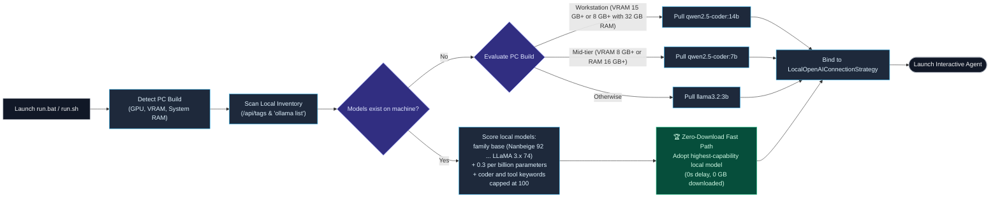
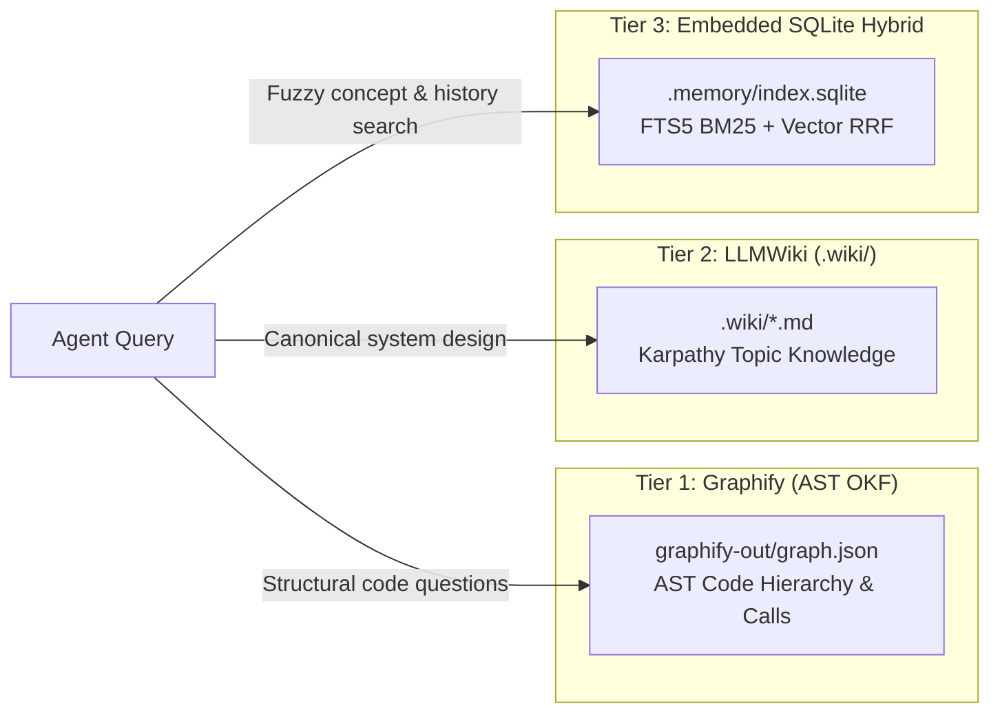

# Local Google Antigravity agent (open-source edition)

> Run fully autonomous, private AI agents on your local machine using the official Google Antigravity SDK (`google-antigravity`) connected to local models (Ollama, LM Studio, vLLM) or Google's open-source Research AI Harness. No cloud lock-in, no API fees.
>
> Prefer a guided tour? The [project site](https://veeresh-bikkaneti.github.io/antigravity-local/) walks through each step beside a drawing of your machine, with the architecture diagrams.
>
> Prefer to play it? [Play the zero-to-coding game](https://veeresh-bikkaneti.github.io/antigravity-local/game/) - a side-scroller that walks the same nine setup steps, from `run.bat` to Hello World in the editor. It is a walkthrough, not a substitute for running the setup yourself.
>
> Prefer to watch? [Watch the one-minute demo](https://veeresh-bikkaneti.github.io/antigravity-local/#watch) - narrated, from `git clone` to a coding agent on your own machine.
>
> For an end-to-end developer guide with real-world project recipes and the Python SDK handbook, read [ZERO_TO_CODING.md](ZERO_TO_CODING.md).

---

## Run it with one command

No manual environment creation or dependency hunting. Clone the repo and run one command. The bootstrap script sets up your environment, starts Ollama, downloads the best model for your hardware if you have none, runs a demo, and opens an interactive agent chat:

### Windows (CMD or PowerShell):
```cmd
git clone https://github.com/veeresh-bikkaneti/antigravity-local.git
cd antigravity-local
run.bat
```
*(Or in PowerShell: `.\run.ps1` or `python run.py`)*

### macOS / Linux:
```bash
git clone https://github.com/veeresh-bikkaneti/antigravity-local.git
cd antigravity-local
chmod +x run.sh && ./run.sh
```
*(Or: `python3 run.py`)*

**What to expect:** setup takes a few minutes plus the model download, which is roughly 9 GB for the 14B model if you have no model yet. The run goes quiet in the middle while packages install. That is normal, so grab a coffee. Setup ends at a `You >` chat prompt. Type `exit` to leave, or carry on with [the guide](ZERO_TO_CODING.md#4-start-coding-interactive-pair-programmer-shell).

#### What the 1-command bootstrap does automatically:
1. Hardware & Inventory Inspection: Probes dedicated GPU VRAM (via `nvidia-smi` / Apple Silicon) and System RAM. Checks local Ollama inventory first to reuse existing weights with **zero downloads**.
2. Model Matching: Compares your PC build against a list of agentic models (Nanbeige, DeepSeek, Qwen 2.5 Coder, Command-R, Codestral, GLM-4) and picks the most capable one your hardware can run.
3. Virtual Environment Setup: Creates isolated `venv`, installs `requirements.txt`, and generates `.env` if missing.
4. Ollama auto-start: Pings `http://localhost:11434`. If down, launches `ollama serve` in the background.
5. Autonomous Verification: Asks the local agent to create `workspace/index.html` with its built-in tool calling.
6. Interactive Shell: Drops you into an interactive terminal where you can ask your local agent to write code or inspect files.

The demo in step 5 checks whether the file was actually written. If the agent answers without writing anything, it prints a warning instead of claiming success. The same check runs for one-shot tasks in `code_agent.py`.

---

## Play the setup as a game

[Play the zero-to-coding game](https://veeresh-bikkaneti.github.io/antigravity-local/game/) on the project site. It is a side-scrolling walkthrough of the same setup, in nine stations in order:

1. Run the launcher (`run.bat`, `run.sh`, or `run.ps1`)
2. Pull Ollama
3. Pull the model (`qwen2.5-coder:14b`, about 9 GB)
4. Serve it on `:11434`
5. Wire the endpoint for the Antigravity Harness
6. Start the Agent
7. Watch the Agent call Ollama and get a `tool_call` back
8. Write a file in the workspace, through the Policy Gate
9. Memory + Editor: it ends with the local model saying Hello World in the IDE

Each station is guarded by the system it sets up, and clearing it drops that system's tool into a pocket that fills up to POCKET FULL. The game is a documentation walkthrough: it shows the real commands and the real flow, but it does not run Ollama, pull a model, or write a file for you. To actually set up, run the one command above.

The game page lives in the repo at `site/public/game/index.html`. The site build (Vite) copies everything in `site/public/` into the published site, so the game is served at `/game/`. A plain `site/game/` file would not be published, and that is how the page 404'd when it was first added.

---

## Serve it: search UI + API on a free port (local or Docker)

Prefer a browser to a terminal? Both paths below start the same small web app: a memory search page, a JSON API, and your interactive diagrams. There is no fixed port. The OS hands out a free one, so it never fights with whatever else is running on your machine.

**Path A: run it locally (bootstrapped, no Docker):**
```bash
python run.py --serve          # prints: Serving on http://127.0.0.1:<free-port>
python run.py --serve --port 9000   # or pick one yourself
```
First run builds its own virtualenv and installs dependencies, so grab a coffee. After that it starts in seconds. It needs no Ollama. Memory search uses the built-in fallback vectors. The web app has no login. It binds to `127.0.0.1` locally, and the Docker image binds to `0.0.0.0` inside the container, so publish the port to `127.0.0.1` only. It indexes memory on startup.

**Path B: run the Docker image (nothing installed on your machine):**
```bash
docker build -t antigravity-local .      # works today
docker run -d --rm -p 127.0.0.1::8000 --name ag antigravity-local
docker port ag 8000            # shows the random host port, e.g. 127.0.0.1:54921
```
`127.0.0.1::8000` means "any free host port, reachable only from this machine". Open the printed address in your browser. Locked-down setups work too: a forced user id (`--user 12345:12345`) and a read-only filesystem (`--read-only --tmpfs /app/.memory`, which keeps the search index in memory). `python tests/e2e.py docker` tests both. Want to skip the build? The image is public on GitHub's container registry. Run `docker pull ghcr.io/veeresh-bikkaneti/antigravity-local:latest`, then use `ghcr.io/veeresh-bikkaneti/antigravity-local:latest` in place of `antigravity-local` in the `docker run` command above.

| URL | What you get |
| :--- | :--- |
| `/` | Search page + diagram links |
| `/api/search?q=hardware+offloading&limit=5` | JSON results (limit 1-20, query up to 500 chars) |
| `/healthz` | `{"status":"ok", ...}` (Docker uses this for its HEALTHCHECK) |
| `/diagrams/system-topology.html` | Interactive architecture diagrams |

**Prove it works (real end-to-end, both paths):**
```bash
python tests/e2e.py local    # fresh copy, own venv, two servers on two free ports
python tests/e2e.py docker   # builds the image, runs two containers on two random host ports
```

### Stop & clean up (teardown)

Everything you start has an off switch, and everything it leaves behind is safe to delete. Nothing here touches your Ollama models.

| What you started | How to stop it | What it leaves behind | Remove that with |
| :--- | :--- | :--- | :--- |
| Local server (`run.py --serve`) | `Ctrl+C` in its terminal | `venv/` and `.memory/` (search index, about 1 MB). Both rebuild themselves next run. | PowerShell: `Remove-Item -Recurse -Force venv, .memory`. macOS/Linux/Git Bash: `rm -rf venv .memory` |
| Docker container | `docker stop ag` (it was started with `--rm`, so it deletes itself) | The image | `docker rmi antigravity-local` |
| `tests/e2e.py local` / `docker` | Nothing, they clean up after themselves | Nothing. Their servers, containers, images and temp folders are removed | n/a |
| Archify global install | n/a | A global `archify` command | `npm uninstall -g archify` |

Forgot the container name? `docker ps` lists running ones, then `docker stop <id>`. Want your disk back from Ollama too? That is up to you, and this repo never does it for you. Run `ollama list`, then `ollama rm <model>`.

## Use your local model from Antigravity or VS Code

Ollama holds the model. Every tool below just knocks on its door at `http://localhost:11434` (the OpenAI-style address is `http://localhost:11434/v1`). So the order is always the same: start Ollama, run `ollama list`, and copy the model name exactly as it prints, for example `qwen2.5:14b`. Then pick your editor.

*Agent facts checked on Nov. 14, 2026, editor extension routes on Nov. 4, 2026. These tools rename their settings often. If a label differs from what you see, follow the linked guide.*

### Pick a coding agent

Want something sturdier than the built-in shell? One command sets up a terminal coding agent that already knows about your local model. It installs the agent only if you say yes, adds an Ollama entry to the agent's own config without touching anything else in it, and starts it in the folder you are standing in.

```bash
python run.py --agent pi          # or opencode, or codex
python run.py --agent pi --agent-config-only   # write the config, print the start command, stop
```

| Agent | What it is | Install (we offer to run it) | One command | License | Best for |
|-------|-----------|------------------------------|-------------|---------|----------|
| `shell` (default) | This repo's Antigravity SDK shell | Nothing | `python run.py` | MIT | Creating new files, zero extra installs |
| `pi` | A minimal agent with four tools (read, write, edit, bash) and a short system prompt | `npm install -g @earendil-works/pi-coding-agent` (needs Node 22.19+) | `python run.py --agent pi` | MIT | Small local models: less prompt to get lost in |
| `opencode` | A fuller agent with MCP, LSP and sub-agents | `npm install -g opencode-ai` | `python run.py --agent opencode` | MIT | More features, and bigger models |
| `codex` | OpenAI's terminal agent, pointed at Ollama with `--oss` | `npm install -g @openai/codex` | `python run.py --agent codex` | Apache-2.0 | Zero config files to manage |

Three things worth knowing before you press Enter:

- **Give it room to think.** All three agents want a context window of 64k tokens or more, and Ollama's default is smaller on most PCs (4k below 24 GB of VRAM, per [Ollama's context-length page](https://docs.ollama.com/context-length)). Raise it in the Ollama app's settings, or start the server with `OLLAMA_CONTEXT_LENGTH=65536` ([Ollama's FAQ](https://docs.ollama.com/faq)). We print this reminder but never change your Ollama settings.
- **Your config is safe.** We merge into `~/.pi/agent/` or `~/.config/opencode/opencode.json`, keep every other provider and setting, and save a one-time backup next to a changed file (ending `.bak-antigravity-local`). If a config file is not valid JSON, we stop and tell you which file, rather than guess. Run it twice and the second run changes nothing. `codex` needs no file at all, and it only talks to Ollama on its default port. pi gets its provider and model as launch flags, so we never rewrite your own pi default. If an earlier version of this setup changed your pi default, the `.bak-antigravity-local` file next to `~/.pi/agent/settings.json` holds your old one.
- **We tested the setup, not the magic.** The config writing, the install prompt and the hand-off are covered by offline tests. We have not yet measured how well each agent edits an existing file with your model, which is the weak spot noted below. If you try one, tell us how it went.

Ollama has its own helper too: `ollama launch pi` or `ollama launch opencode` installs and configures them for you ([Ollama's pi guide](https://docs.ollama.com/integrations/pi), [OpenCode guide](https://docs.ollama.com/integrations/opencode)). Our command does the same job but keeps the model you picked in the menu and writes only what it needs to.

### Claude Code with a local model (manual, and mind your subscription)

Ollama speaks a subset of the Anthropic Messages API, so Claude Code can talk to your local model ([Ollama's Claude Code guide](https://docs.ollama.com/integrations/claude-code), [Anthropic compatibility](https://docs.ollama.com/api/anthropic-compatibility)). We have not built a `--agent claude` option and we have not tested this route ourselves. If you try it, here is what bites people:

- **Do not let it touch your subscription.** If you sign in to Claude Code with a Claude subscription, setting a base URL in your shell profile or in `~/.claude/settings.json` sends every session to the local model instead. Ollama's guide also warns that Claude settings can override shell variables. Set the variables for one terminal only, then run `/status` inside Claude Code to see where it is really connected:
  ```bash
  # macOS / Linux / Git Bash, one command, nothing saved
  ANTHROPIC_BASE_URL=http://localhost:11434 ANTHROPIC_AUTH_TOKEN=ollama ANTHROPIC_API_KEY="" claude --model <your model tag>
  ```
  ```powershell
  # PowerShell: these last only for this window
  $env:ANTHROPIC_BASE_URL = "http://localhost:11434"; $env:ANTHROPIC_AUTH_TOKEN = "ollama"; $env:ANTHROPIC_API_KEY = ""; claude --model <your model tag>
  ```
  Ollama does not check the token, so `ollama` is just a placeholder. A separate config folder (the `CLAUDE_CONFIG_DIR` variable) should keep this setup away from your subscription login. That is our understanding of Claude Code, and we have not tested it with Ollama.
- **No `/v1` on this one.** Anthropic clients add the path themselves, so the base URL is plain `http://localhost:11434`. The `/v1` address our other agents use would end up as `/v1/v1/messages`.
- **Claude Code asks for Anthropic model names** for some background jobs, and Ollama has no model by that name. Ollama's workaround is to copy a local model under the name it wants, for example `ollama cp <your model tag> claude-3-5-sonnet`.
- **Some Anthropic features are missing:** `tool_choice`, prompt caching, token counting, citations and PDF input. Extended-thinking budgets are accepted but not enforced, and hosted web search is not fully supported.
- **The model is the real limit.** Claude Code sends a big system prompt and many tool definitions, so give Ollama a 64k+ context. A local 14B model will not match the Claude model your subscription gives you, and our own tests found existing-file edits unreliable with `qwen2.5:14b`. Use the local route for private or offline work, and keep your subscription for the hard jobs.
- **Ollama's own helper** is `ollama launch claude`. We have not checked which files it changes, so if you use it, run `/status` afterwards.

### Antigravity
- **The Antigravity SDK works with your local model.** Google added local-model support on Sept. 23, 2026. `LocalOpenAIAgentConfig` connects to any OpenAI-compatible server, including Ollama ([Google's announcement](https://developers.googleblog.com/introducing-support-for-local-ai-models-in-the-antigravity-sdk/)). This repo already uses it. `python run.py` and `python code_agent.py` talk to `LOCAL_LLM_BASE_URL` (default `http://localhost:11434/v1`) and `LOCAL_LLM_MODEL` (default `qwen2.5:14b`). To change either, set the variable in `.env` or pass `--base-url` and `--model`.
- **The Antigravity app and its IDE agent panel have no local-model setting.** Google's [plans page](https://antigravity.google/docs/plans) says bring-your-own-key and bring-your-own-endpoint are not supported. If Google changes that, this page is the place to update.
- **The Antigravity CLI (`agy`) and Gemini CLI can reach a local model only through a translator, and that route is experimental.** Both read `GOOGLE_GEMINI_BASE_URL`, but it must point at a Gemini-format endpoint, and Ollama does not speak Gemini. A proxy such as LiteLLM can translate, as long as it has an alias for every Gemini model name the CLI sends (Gemini CLI also needs `--sandbox=false`). Small local models often fail tool calls this way. It is documented for Gemini CLI ([LiteLLM's tutorial](https://docs.litellm.ai/docs/tutorials/litellm_gemini_cli), [one walkthrough](https://dev.to/polar3130/using-gemini-cli-with-a-local-llm-5f5l)). We found nothing that confirms it for `agy`. Here is a sketch, which we have not run:
  ```yaml
  # litellm config.yaml: one entry per Gemini model name your CLI asks for
  model_list:
    - model_name: gemini-2.5-pro
      litellm_params:
        model: ollama_chat/qwen2.5:14b
        api_base: http://localhost:11434
  ```
  Then `litellm --config config.yaml --port 4000` and `export GOOGLE_GEMINI_BASE_URL=http://localhost:4000`. Treat it as a science project, not a setup.
- **Skip the patches that inject other models into the desktop app.** They edit the app's own files, they break on every update, and we have seen reports of Google cutting off accounts that connected third-party agents to its backend. We do not ship or recommend them.
- **What works today inside Antigravity (or any VS Code-style editor):** open your project, open the built-in terminal, and run `python run.py --agent pi` (or `opencode`). No venv activation is needed, because `run.py` sets itself up. The agent edits the files in the folder you have open, so new files show up in the editor as they appear. Prefer the SDK shell? `python code_agent.py --workspace .` still works.

### VS Code
Four ways, easiest first. All of them use the same Ollama on `http://localhost:11434`.

1. **Our shell in the built-in terminal.** Open Terminal, then New Terminal. Activate the venv and run `python code_agent.py --workspace .`. No extension needed.
2. **The Ollama extension** ([Ollama's guide](https://docs.ollama.com/integrations/vscode)). Install the extension with the ID `Ollama.ollama`, open Chat, open the model picker at the bottom of the chat box, and choose your model from the **Ollama** section. It needs VS Code 1.127 or newer. For local models, set the context length to at least 64k in Ollama's Settings, then reload the VS Code window. If your model is missing, run **Ollama: Refresh Models** or **Ollama: Diagnose Models** from the Command Palette.
3. **Continue** ([Continue's guide](https://docs.continue.dev/guides/ollama-guide)). Add this model to Continue's `config.yaml`:
   ```yaml
   models:
     - name: Qwen 2.5 14B
       provider: ollama
       model: qwen2.5:14b   # must match `ollama list` exactly
       apiBase: http://localhost:11434
       roles:
         - chat
         - edit
       capabilities:
         - tool_use
   ```
4. **Cline** ([Cline's guide](https://docs.cline.bot/running-models-locally/ollama)). Open Cline's settings, choose **Ollama** as the provider, keep the Base URL at `http://localhost:11434`, and pick your model from the dropdown. Cline's guide says to turn on **Use Compact Prompt**.

Good to know:
- Agent modes need a model that supports tools. `qwen2.5:14b` does. `gemma2` does not (see [troubleshooting](#common-gotchas--troubleshooting)).
- **Know the limits of a small local model.** With the default `qwen2.5:14b`, creating a new file from a plain prompt worked in most of our runs. Jobs that start from an existing file did not. In 14 attempts to edit a file, or to read one and write a new one, none gave a correct result. Some runs wrote nothing, some rewrote the file wrongly, and one answered in Thai. For work on existing code, use the editor routes above with the same local model, or try a larger tool-calling model from the table in this README (we have not tested one).
- When you run `code_agent.py --workspace .`, the agent can change any file in that folder. Commit first. Then `git status` and `git diff` show what it did, and `git restore .` reverts its edits to existing files. New files stay until you delete them. Check `git diff` before you trust a "Task completed" line, because that line only means a file changed.
- We tested the terminal route and the endpoints above on Windows. The extension routes come from their official guides, and we have not run them in VS Code ourselves.

---

## Table of contents
0. [Serve it: search UI + API on a free port](#serve-it-search-ui--api-on-a-free-port-local-or-docker)
0. [Play the setup as a game](#play-the-setup-as-a-game)
1. [Use your local model from Antigravity or VS Code](#use-your-local-model-from-antigravity-or-vs-code)
2. [Run it with one command](#run-it-with-one-command)
3. [What is Antigravity Local?](#what-is-this)
4. [Prerequisites & model selection](#prerequisites-checklist)
5. [Developer coding agent (`code_agent.py`)](#mode-3-developer-pair-programming-shell-code_agentpy)
6. [3-tier zero-token memory fabric](#3-tier-zero-token-memory-fabric-graphify--llmwiki--sqlite-hybrid)
7. [Architecture & interactive diagrams](#system-architecture--design-diagrams)
8. [1-command Docker clean-room test drive](#1-command-docker-clean-room-test-drive)
9. [Project structure](#project-structure)
10. [Common gotchas & troubleshooting](#common-gotchas--troubleshooting)
11. [Advanced: custom harnesses & backends](#advanced-using-custom-research-harnesses--servers)
12. [Credits, toolchain heritage & specifications](#credits-toolchain-heritage--specifications)
13. [License & contributing](#license--contributing)

---

## What is this?

Google Antigravity is the SDK this repo builds on. It runs an agent loop that reads and writes files in a workspace and calls tools, and it can talk to any OpenAI-compatible server. 

Normally, developer tools configure Antigravity to call cloud Gemini APIs. This repository shows you how to point Antigravity at local models running on your own PC.

- Private inference: Your code, files, and prompts go to a model on your own hardware. Setup still downloads Python packages, Ollama, and the model.
- Zero Cost: No OpenAI or Google Cloud API subscriptions required.
- Autonomous Tool Calling: The agent can inspect folders, read code, write files, and execute commands locally, under the safety policy you set (the demo scripts use `policy.allow_all()`).

---

## Prerequisites checklist

Before you start, make sure you have:

| Requirement | Minimum | Recommended | Notes |
| :--- | :--- | :--- | :--- |
| **Operating System** | Windows 10/11, macOS, Linux | Any modern 64-bit OS | Native setup tested on Windows 11 only. The Docker image runs on Linux in CI. |
| **Python** | 3.11 | 3.12 or 3.13 | Check with `python --version`. |
| **System RAM** | 8 GB | 16 GB - 32 GB | More RAM allows running larger models. |
| **GPU (Optional)** | None (runs on CPU) | NVIDIA RTX (8GB+) or Apple Silicon | GPU speeds up token generation. |
| **Ollama** | Installed & running | [ollama.ai](https://ollama.ai/download) | Local LLM inference server. Free disk: about 10 GB for the 14B model. |

---

## Step-by-step manual setup (optional alternative)

If you prefer to configure each component step-by-step rather than using the 1-command bootstrap (`run.bat` / `run.sh` / `run.py`):

### Step 1: install & verify Ollama
1. Download and install Ollama from [ollama.ai/download](https://ollama.ai/download).
2. Open a terminal and check that Ollama is responding:
   ```bash
   ollama --version
   ```

### Step 2: check local models & select best for your PC build

> Check what is already installed before downloading anything. If you have a capable agent model, the bootstrap reuses it with no download.

1. Check what models are already on your machine:
   ```bash
   ollama list
   ```
2. **If you already have a capable model installed, skip the download. You are ready to code.**  
   The bootstrap script scans your local inventory and picks the highest-scoring model:
   - **`nanbeige`** (e.g., `nanbeige2:16b`, `nanbeige4.3:16b`, `nanbeige4.1:3b`): Multi-step agentic search and sequential tool calling.
   - **`deepseek-coder-v2` / `deepseek-r1`** (e.g., `deepseek-coder-v2:16b`, `deepseek-r1:14b`): Code generation, fill-in-the-middle, and algorithmic problem solving.
   - **`qwen2.5-coder` / `qwen2.5`** (e.g., `qwen2.5-coder:14b`, `qwen2.5:14b`, `qwen2.5-coder:32b`): Open-weights coding model with native OpenAI function calling.
   - **`command-r`** (e.g., `command-r:35b`): Cohere's model built for multi-step tool execution and structured outputs.
   - **`codestral`** (e.g., `codestral:22b`): Mistral's coding model with a 32k context window.
   - **`glm4`** (e.g., `glm4:9b`): Good tool use, function calling, and multilingual reasoning.
   - **`llama3.3` / `llama3.1`** (e.g., `llama3.3:70b`, `llama3.1:8b`): General-purpose models.
   - **`gemma2`** (e.g., `gemma2:27b`, `gemma2:9b`): Dense reasoning and fast streaming (tools disabled).

3. Only if you have no models installed, pick the model that matches your PC build:

| PC Build Tier | Hardware Specs | Recommended models | Pull Command |
| :--- | :--- | :--- | :--- |
| **High-End Workstation** | 15 GB or more VRAM, or 8 GB VRAM with 32 GB RAM | **`qwen2.5-coder:14b`** *(Fits 100% in 16GB VRAM)*<br/>**`nanbeige2:16b`** *(scores high in `run.py`, but coder models score higher)*<br/>**`deepseek-coder-v2:16b`** *(Deep code synthesis)*<br/>**`command-r:35b`** *(Layer offload to RAM)* | `ollama pull qwen2.5-coder:14b`<br/>*(or `ollama pull nanbeige2:16b`)* |
| **Mid-Tier PC** | 8 GB or more VRAM, or 16 GB or more RAM | **`qwen2.5-coder:7b`**<br/>**`nanbeige4.1:3b`**<br/>**`deepseek-coder:6.7b`**<br/>**`glm4:9b`** | `ollama pull qwen2.5-coder:7b` |
| **Entry / CPU Only** | Anything smaller | **`llama3.2:3b`**<br/>**`qwen2.5:3b`**<br/>**`nanbeige4.1:3b`** | `ollama pull llama3.2:3b` |

### Step 3: clone the repository & 1-command setup

```bash
git clone https://github.com/veeresh-bikkaneti/antigravity-local.git
cd antigravity-local
```

#### Option A: 1-click automated setup (recommended)
- Windows:
  ```cmd
  setup.bat
  ```
- macOS / Linux:
  ```bash
  chmod +x setup.sh && ./setup.sh
  ```
*(This automatically creates a virtual environment, installs dependencies from `requirements.txt`, and generates your `.env` file.)*

#### Option B: manual setup
```bash
# 1. Create a virtual environment
#    Windows:
python -m venv venv
#    macOS / Linux (many have no plain 'python'), use this line instead:
# python3 -m venv venv
```

**Activate your virtual environment:**
- Windows PowerShell:
  ```powershell
  # If PowerShell blocks scripts, run this first:
  Set-ExecutionPolicy -Scope Process -ExecutionPolicy Bypass
  .\venv\Scripts\Activate.ps1
  ```
- Windows Command Prompt: `venv\Scripts\activate.bat`
- Git Bash on Windows: `source venv/Scripts/activate`
- macOS / Linux:
  ```bash
  source venv/bin/activate
  ```

### Step 4: install dependencies
```bash
pip install -r requirements.txt
```

### Step 5: configure your environment (optional)
Copy the example environment configuration:
- Windows PowerShell:
  ```powershell
  Copy-Item .env.example .env
  ```
- macOS / Linux:
  ```bash
  cp .env.example .env
  ```
*By default, the `.env` points to `http://localhost:11434/v1` with model `qwen2.5:14b`. No edits needed if you use the defaults.*

### Step 6: test your agent!

#### Test 1: live token streaming (`test_local.py`)
Verify your local connection to Ollama and watch tokens stream live to your console:
```bash
python test_local.py
```

#### Test 2: autonomous workspace agent (`agent_with_workspace.py`)
Watch the local Antigravity agent inspect its workspace, invoke its built-in `create_file` tool, and write a dark-mode `index.html` to disk:
```bash
python agent_with_workspace.py
```
When it finishes, open the generated file at `workspace/index.html`. If you see a warning that the agent did not create it, run the command again. Small local models sometimes answer without writing anything.

#### Mode 3: developer pair-programming shell (`code_agent.py`)
Pair program with your local agent, or hand it a one-shot task:
```bash
# 1. Interactive pair-programming shell in ./workspace:
python code_agent.py --workspace ./workspace

# 2. One-shot autonomous coding task:
python code_agent.py --workspace ./workspace --task "Create a Python CLI calculator with unit tests"

# 3. Use a specific model (e.g., Nanbeige or Qwen):
python code_agent.py --model nanbeige4.1:3b
```

---

## Project structure

```
antigravity-local/
├── run.py                    # ⚡ 1-Command Plug & Play auto-bootstrap orchestrator
├── run.bat                   # 1-Click launcher for Windows
├── run.sh                    # 1-Command launcher for macOS & Linux
├── run.ps1                   # 1-Command launcher for PowerShell
├── setup.bat                 # Standalone venv setup for Windows
├── setup.sh                  # Standalone venv setup for macOS & Linux
├── .env.example              # Template environment variables (server URL, model, paths)
├── requirements.txt          # Minimal Python dependencies (google-antigravity, python-dotenv)
├── LICENSE                   # Open-source MIT License
├── README.md                 # Complete beginner & developer documentation
├── ZERO_TO_CODING.md         # 📖 E2E Master Guide: From Zero to Coding Real Apps
├── test_local.py             # Script 1: Tests local connection & real-time token streaming
├── agent_with_workspace.py   # Script 2: Autonomous agent with file creation tools
├── code_agent.py             # Script 3: Interactive developer coding shell & pair-programmer
├── memory.py                 # Tier 3 memory engine: SQLite FTS5 + vector search
├── agent_setup.py            # One-step setup for pi / OpenCode / Codex (python run.py --agent pi)
├── serve.py                  # Web UI + JSON API on a free port (python run.py --serve)
├── Dockerfile                # Image for the Docker path (non-root, HEALTHCHECK)
├── tests/                    # Regression tests (stdlib unittest) + tests/e2e.py (local & docker)
├── site/                     # GitHub Pages front page (Vite, Three.js, GSAP). Dev: cd site && npm install && npm run dev
│   ├── public/game/index.html # Zero-to-coding side-scroller game, served at /game/
│   └── src/                   # Front-page drawing (scene.js) and styles
└── workspace/                # Sandboxed folder where the agent creates/edits files
    ├── .gitkeep              # Keeps directory tracked in git
    └── index.html            # Artifact generated automatically by the agent
```

---

## System architecture & design diagrams

Antigravity Local runs the Google Antigravity SDK's agent loop on your machine and sends model calls to a local inference server, so nothing goes to the cloud.

### 1. System topology architecture

The diagram below shows how the launcher scripts, the Google Antigravity SDK, Ollama, and GPU/RAM offloading connect:

```mermaid
graph TB
    subgraph Host["Local host machine (inference stays local)"]
        subgraph ClientLayer["Client & Orchestration Layer"]
            CLI["CLI Launchers<br/>(run.bat / run.sh / run.ps1)"]
            Bootstrap["Bootstrap Engine<br/>(run.py)"]
            CodeAgent["Developer Agent Shell<br/>(code_agent.py)"]
        end

        subgraph SDKLayer["Google Antigravity SDK Runtime Core"]
            Agent["Agent Runtime Loop<br/>(google.antigravity.Agent)"]
            Router["LocalOpenAI Router<br/>(LocalOpenAIConnectionStrategy)"]
            Policy["Safety Policy<br/>(policy.allow_all())"]
            Harness["Workspace Harness<br/>(create_file, edit_file, read_file)"]
        end

        subgraph LocalInference["Local Inference & Hardware Offload Layer"]
            Ollama["Ollama REST Daemon<br/>(http://localhost:11434/v1)"]
            ModelWeights["Local Model Weights<br/>(Nanbeige / DeepSeek / Qwen / Codestral)"]
            GPU["GPU VRAM<br/>(example: 16 GB card)"]
            RAM["Host system RAM<br/>(layer offload)"]
        end

        subgraph Sandbox["Workspace Storage Boundary"]
            Workspace["./workspace/*<br/>(Isolated Code & Artifacts)"]
            Memory["CONTEXT_MEMORY.md<br/>(Persistent State & Session Log)"]
        end
    end

    CLI -->|1-click launch| Bootstrap
    CLI -.->|interactive REPL| CodeAgent
    Bootstrap -->|provisions & starts| Agent
    CodeAgent -->|dispatches tasks| Agent

    Agent -->|routes LLM queries| Router
    Router -->|HTTP SSE :11434| Ollama
    Ollama -->|loads active weights| ModelWeights

    ModelWeights -->|"weights fit in VRAM"| GPU
    ModelWeights -.->|"layers spill to RAM"| RAM

    Agent -->|permission check| Policy
    Policy -->|authorizes file I/O| Harness
    Harness -->|reads & writes| Workspace

    classDef host fill:#0f172a,stroke:#334155,stroke-width:2px,color:#f8fafc;
    classDef client fill:#1e293b,stroke:#38bdf8,stroke-width:1px,color:#e0f2fe;
    classDef sdk fill:#1e1b4b,stroke:#818cf8,stroke-width:1px,color:#e0e7ff;
    classDef inf fill:#064e3b,stroke:#34d399,stroke-width:1px,color:#d1fae5;
    classDef store fill:#312e81,stroke:#a78bfa,stroke-width:1px,color:#ede9fe;

    class Host host;
    class CLI,Bootstrap,CodeAgent client;
    class Agent,Router,Policy,Harness sdk;
    class Ollama,ModelWeights,GPU,RAM inf;
    class Workspace,Memory store;
```



---

### 2. Autonomous tool calling execution sequence

This sequence diagram shows the loop the agent runs when a task needs workspace changes:

```mermaid
sequenceDiagram
    autonumber
    actor Developer as Developer / CLI
    participant Agent as Antigravity Agent Runtime
    participant Strategy as LocalOpenAI Router
    participant Ollama as Ollama Daemon (:11434)
    participant Policy as Security Policy
    participant Harness as Workspace Harness
    participant Disk as Workspace Filesystem

    Developer->>Agent: task: "Generate landing page in index.html"
    Note over Agent: Compiles prompt, system instruction,<br/>and available tool schemas
    Agent->>Strategy: stream_chat(messages, tools=[create_file, edit_file])
    Strategy->>Ollama: POST /v1/chat/completions (OpenAI compatible SSE)
    
    activate Ollama
    Note over Ollama: Model infers task requirements<br/>and triggers tool call
    Ollama-->>Strategy: Yield tool_call: create_file(path="index.html", content="...")
    deactivate Ollama

    Strategy-->>Agent: Dispatched tool invocation
    
    activate Agent
    Agent->>Policy: Intercept tool call: verify permission for create_file
    activate Policy
    Policy-->>Agent: policy.allow_all() APPROVED (workspace-scoped)
    deactivate Policy

    Agent->>Harness: invoke create_file("index.html", content, overwrite=True)
    activate Harness
    Harness->>Disk: Write ./workspace/index.html
    Disk-->>Harness: file written
    Harness-->>Agent: Observation: "File index.html created successfully"
    deactivate Harness

    Note over Agent: Evaluates result; determines task is complete
    Agent-->>Developer: "Task complete. Generated modern landing page at workspace/index.html"
    deactivate Agent
```

---

### 3. Hardware-aware model selection & zero-download pipeline



---

### 4. Interactive visualizations & Archify integration

This repository uses [**Archify** (`tt-a1i/archify`)](https://github.com/tt-a1i/archify). Archify compiles structured JSON intermediate representations (IR) into standalone, interactive HTML files with dark/light themes, pan/zoom, and live trace motion:

| Diagram | Type | Scope | Standalone Interactive Link |
|---|---|---|---|
| **System Topology & Architecture** | `architecture` | Host boundary, Antigravity SDK decoupling, GPU VRAM vs. RAM offload | [**system-topology.html**](docs/diagrams/system-topology.html) |
| **1-Command Bootstrap Lifecycle** | `workflow` | Automated hardware audit, venv provisioning, Ollama auto-spawn, REPL | [**bootstrap-workflow.html**](docs/diagrams/bootstrap-workflow.html) |
| **Autonomous Tool Calling Sequence** | `sequence` | Multi-turn loop: Developer $\to$ Agent $\to$ Router $\to$ Ollama $\to$ Policy $\to$ Workspace Disk | [**agent-tool-execution.html**](docs/diagrams/agent-tool-execution.html) |
| **Model Pre-Check & Capability Pipeline** | `workflow` | Zero-download inventory pre-flight (`/api/tags`) and scoring hierarchy | [**model-pipeline-workflow.html**](docs/diagrams/model-pipeline-workflow.html) |

---

### How to view & serve interactive Archify diagrams

There are three ways to preview the diagrams:

#### Option 1: live interactive preview via Archify CLI (recommended)
Archify is installed globally as a CLI. Running `archify preview` starts a local live-reload server and opens your browser:

```bash
# 1. Preview System Topology & Component Architecture:
archify preview architecture docs/diagrams/system-topology.architecture.json

# 2. Preview 1-Command Plug & Play Bootstrap Lifecycle:
archify preview workflow docs/diagrams/bootstrap-workflow.workflow.json

# 3. Preview Autonomous Tool-Calling Execution Loop:
archify preview sequence docs/diagrams/agent-tool-execution.sequence.json

# 4. Preview Model Inventory & Capability Selection Pipeline:
archify preview workflow docs/diagrams/model-pipeline-workflow.workflow.json
```

#### Option 2: instant browser open (zero server / zero dependencies)
Archify compiles each diagram into a self-contained HTML file (the CSS, SVG, themes, and motion engine are all inside it), so you can open any diagram in your browser with no server running:

* **Windows PowerShell**:
  ```powershell
  Start-Process "docs\diagrams\system-topology.html"
  ```
* **Windows CMD**:
  ```cmd
  start docs\diagrams\system-topology.html
  ```
* **macOS**:
  ```bash
  open docs/diagrams/system-topology.html
  ```
* **Linux**:
  ```bash
  xdg-open docs/diagrams/system-topology.html
  ```
*(Or double-click any `.html` file inside [`docs/diagrams/`](docs/diagrams/) in File Explorer / Finder).*

#### Option 3: local Python HTTP web server
To serve all diagrams on a local port:
```bash
python -m http.server 8080 --directory docs/diagrams
```
Navigate to: [http://localhost:8080/system-topology.html](http://localhost:8080/system-topology.html)

#### Archify CLI quick reference
```bash
# Verify Archify installation & system health:
archify doctor

# Validate diagram JSON syntax and layout clearance:
archify validate architecture docs/diagrams/system-topology.architecture.json

# Compile/render JSON into standalone HTML:
archify render architecture docs/diagrams/system-topology.architecture.json docs/diagrams/system-topology.html
```

---

## 3-tier zero-token memory fabric: Graphify + LLMWiki + SQLite hybrid

Local coding agents (such as Qwen 2.5 14B) paired with cloud IDE sessions (Antigravity Gemini/Claude) need to keep context across sessions without filling the prompt context window.

### Why not a standalone vector DB (Milvus, Qdrant, Chroma)?
- 1-Command Plug-and-Play: Standalone vector DBs need Docker daemons, listening ports (6333, 8000, 19530), and C++ dependencies. That breaks our zero-dependency promise.
- Exact Code Matching: Vector embeddings often miss exact identifiers (e.g. `get_hardware_profile` or CLI flags).
- Token Inefficiency: Traditional RAG injects large text chunks into prompts, burning 20,000+ tokens per query.

### The solution: 3-tier memory architecture



| Tier | Engine & Location | Purpose | Token Cost |
| :--- | :--- | :--- | :--- |
| **Tier 1: Deterministic Code Graph** | [`graphify`](.agents/rules/graphify.md) in `graphify-out/` | Deterministic AST code relationships, call hierarchies, and community clusters. | **0 tokens to build**; about 800 tokens to query (Graphify's own report cites a 31x to 128x reduction; we did not re-measure it). |
| **Tier 2: High-Density LLMWiki** | `.wiki/*.md` (Karpathy-style) | Atomic, curated Markdown concept pages (`architecture.md`, `hardware-matrix.md`, `model-hierarchy.md`). | **~850 tokens** per topic page (a page is a small fraction of the repo's tokens). |
| **Tier 3: Embedded Hybrid Store** | [`memory.py`](memory.py) (`.memory/index.sqlite`) | SQLite FTS5 BM25 exact match + cosine semantic vector fusion with Reciprocal Rank Fusion (RRF). | **~1,200 tokens** per hybrid search (one manual benchmark on one laptop: median 8.10 ms against 1,877.4 ms for reading the whole repo, 5 alternating runs). |

### Memory engine CLI commands

```bash
# 1. Index all repository memory (wiki, docs, context memory, and core code):
python memory.py index

# 2. Hybrid search across indexed memory with BM25 + Vector Fusion:
python memory.py search "how does hardware offloading work with 16GB VRAM"

# 3. View memory database status and chunk breakdown:
python memory.py status

# 4. Read canonical LLMWiki topic pages directly:
python memory.py wiki architecture
python memory.py wiki hardware-matrix

# 5. Dual-Sync: Update Graphify AST graph + SQLite memory store in one shot:
python memory.py sync
```

### Interactive shell memory integration (`code_agent.py`)

In the developer pair-programming shell, use memory commands directly:

```bash
# Launch interactive coding shell:
python code_agent.py

# Or launch with automatic memory context injection enabled:
python code_agent.py --with-memory
```

Graphify is not part of the runtime agent path. Only `python memory.py sync` calls `graphify update .`, and only when `graphify` is installed. The committed graph has 8,547 nodes and 13,383 edges.

Inside the interactive shell:
- `/memory <query>` : Searches project memory with BM25 + Vector fusion and displays matching lines.
- `/wiki [topic]`   : Shows the canonical topic pages from `.wiki/`.
- `/files`          : Lists all files currently in the workspace.
- `/clear`          : Resets the conversation with a fresh agent session.

`--with-memory` prepends the top 2 memory excerpts (1,200 characters each) to every prompt.

---

## 1-command Docker clean-room test drive

> Looking to *run* the app in Docker? That is [Serve It](#serve-it-search-ui--api-on-a-free-port-local-or-docker) above. This section covers the older contributor test script (`docker-test-drive.sh`). CI now uses `python tests/e2e.py docker`.

Want to try everything in a clean, disposable Linux container without touching your host Python? [`docker-test-drive.sh`](docker-test-drive.sh) does that in standard Docker Desktop. The script prints what it sees but does not assert, and CI does not run it. CI runs `python tests/e2e.py docker` instead.

```bash
docker run --rm --add-host=host.docker.internal:host-gateway \
  -v "$(pwd):/app" -w /app python:3.11-slim bash docker-test-drive.sh
```

*(CMD: use `%cd%` instead of `$(pwd)`. PowerShell: use `${PWD}`. Git Bash on Windows: put `MSYS_NO_PATHCONV=1` in front of `docker run`, or Git Bash rewrites `/app` into a Windows path. macOS and Linux: as written. Easiest of all, run `python tests/e2e.py docker`.)*

### What the Docker test drive verifies automatically:
1. Clean-Room Dependency Isolation: Installs `google-antigravity` and `python-dotenv` from scratch in `python:3.11-slim`.
2. Memory Engine Initialization: Checks the SQLite FTS5 database and indexes repository knowledge.
3. Hybrid Retrieval: Runs BM25 + dense semantic vector fusion queries with Reciprocal Rank Fusion (RRF).
4. Canonical LLMWiki Loading: Checks that topic pages load from `.wiki/`.
5. CLI Parsing & Safety Flags: Checks `code_agent.py` CLI arguments and `--with-memory` context clamp.
6. Host Inference Bridge: Tests the container-to-host network bridge (`host.docker.internal:11434`), auto-detecting host Ollama models (`qwen2.5:14b`, `gemma2:27b`).

---

## Common gotchas & troubleshooting

### 1. PowerShell: "Running scripts is disabled on this system"
**Cause**: Windows restricts PowerShell script execution by default.  
**Fix**: In your PowerShell window, run:
```powershell
Set-ExecutionPolicy -Scope Process -ExecutionPolicy Bypass
.\venv\Scripts\Activate.ps1
```

### 2. "Connection Refused" or cannot connect to localhost:11434
**Cause**: Ollama is not running in the background.  
**Fix**: Open a terminal and run `ollama serve` (or start the Ollama desktop app from your Start Menu/Applications).

### 3. Model error: "model does not support tools"
**Cause**: Some models (such as `gemma2:27b` in Ollama) do not support function calling / tools in their Ollama templates.  
**Fix**: Use a tool-capable model for `agent_with_workspace.py`:
- `qwen2.5:14b` (Recommended)
- `llama3.1:8b` (Fast / Lightweight)  
*Note: You can still use `gemma2:27b` for text generation and reasoning with `test_local.py`.*

### 4. Windows UnicodeEncodeError ('charmap' codec can't encode character)
**Cause**: The Windows terminal defaults to legacy `cp1252` encoding instead of `UTF-8`.  
**Fix**: Our scripts handle this with:
```python
import sys
if sys.platform == "win32":
    sys.stdout.reconfigure(encoding="utf-8", errors="replace")
```

---

## Advanced: using custom research harnesses & servers

### Pointing to LM Studio, vLLM, or llama.cpp
To use a server other than Ollama, change the `LOCAL_LLM_BASE_URL` in `.env`:
```bash
# Example for LM Studio local server:
LOCAL_LLM_BASE_URL=http://localhost:1234/v1
LOCAL_LLM_MODEL=qwen2.5-14b-instruct

# Example for vLLM or text-generation-webui:
LOCAL_LLM_BASE_URL=http://localhost:8000/v1
LOCAL_LLM_MODEL=Qwen/Qwen2.5-14B-Instruct
```

### Pointing to Google's open-source research AI harness
If you clone and build Google's open-source research agent harness from GitHub, you can override Antigravity's default bundled binary by setting the `ANTIGRAVITY_HARNESS_PATH` environment variable:

```bash
# Linux / macOS:
export ANTIGRAVITY_HARNESS_PATH="/path/to/custom/localharness"

# Windows PowerShell:
$env:ANTIGRAVITY_HARNESS_PATH="C:\path\to\custom\localharness.exe"
```
The SDK detects your custom binary on startup and routes all agent operations through it.

---

## Credits, toolchain heritage & specifications

These projects and workflows shaped this one:

- [GStack by Garry Tan](https://github.com/garrytan/gstack): Inspired the multi-perspective review habit (`/plan-eng-review`, `plan-design-review`, `design-consultation`) we use to pressure-test blast radius, reduce developer cognitive load, and keep terminal and visual hierarchy strict.
- [P-Stack](https://github.com/veeresh-bikkaneti/antigravity-local): Provided the methods we used for architecture (`/architect`), 5-run benchmarking (`/benchmark-checklist`), and adversarial stress-testing (`/interrogate`).
- [Google Antigravity SDK](https://github.com/google/antigravity): The SDK this repo builds on. It provides the agent loop, the local harness connection over WebSockets, and the safety policies.
- [Ollama](https://ollama.ai): Runs the local open-weights models and offloads layers between GPU VRAM and host RAM.
- [Graphify](https://github.com/veeresh-bikkaneti/antigravity-local): Builds the AST code knowledge graph and call graph deterministically, without spending tokens.
- [Archify](https://github.com/tt-a1i/archify): Generates the standalone HTML architecture and lifecycle diagrams with live signal tracing.

### Technical deep-dives & formal specifications
For contributors who want the engineering records behind the project:
- [Product Specification](docs/PRODUCT_SPEC.md): Covers the runtime engine, hardware scheduler, and security model.
- [3-Tier Memory Fabric Specification](docs/MEMORY_SPEC.md): Compares RAG, OKF, and vector DBs, and gives the math for Reciprocal Rank Fusion.
- [Consensus Governance Record](docs/CONSENSUS_MANIFEST.md): Record of the deliberation and verification audit.

---

## License & contributing

This project is licensed under the [MIT License](LICENSE) - free to use, modify, and distribute for personal and commercial projects.

Contributions are welcome. Open an issue or pull request with suggestions, optimizations, or new tool integrations.
