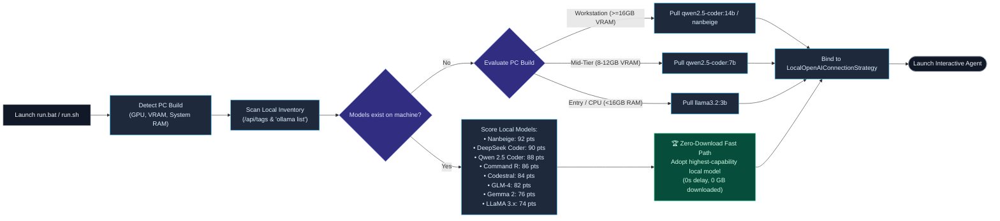
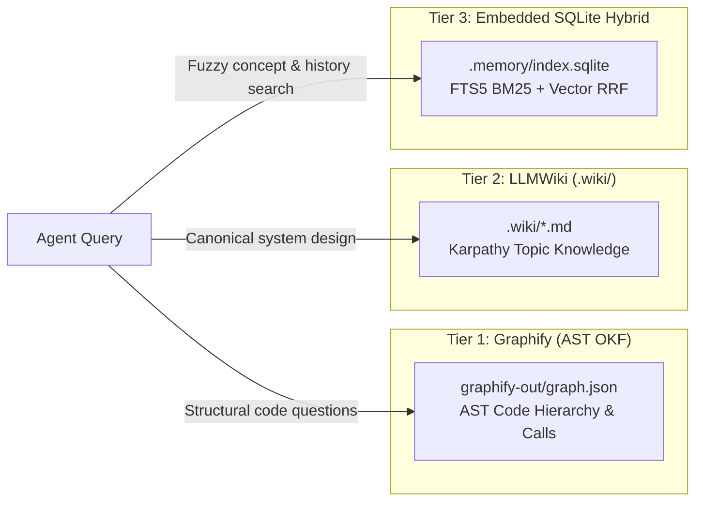

# 🚀 Local Google Antigravity Agent (Open-Source Edition)

> Run fully autonomous, private AI agents on your local machine using the official **Google Antigravity SDK** (`google-antigravity`) connected to local models (**Ollama**, **LM Studio**, **vLLM**) or Google's open-source **Research AI Harness**—with zero cloud lock-in and zero API fees.
>
> 📖 **From Zero to Start Coding**: For an end-to-end developer guide with real-world project recipes and the Python SDK handbook, read **[ZERO_TO_CODING.md](ZERO_TO_CODING.md)**.

---

## ⚡ 1-Command Plug & Play (Zero-Friction Setup)

No manual environment creation or dependency hunting. Clone and run **one command**—the bootstrap orchestrator automatically configures your environment, starts Ollama, downloads the best model for your hardware, runs an autonomous demonstration, and opens an interactive agent chat:

### Windows (CMD or PowerShell):
```cmd
git clone https://github.com/veeresh-bikkaneti/antigravity-local.git
cd antigravity-local
run.bat
```
*(Or in PowerShell: `.\run.ps1` or `python run.py`)*

### macOS / Linux:
```bash
git clone https://github.com/veeresh-bikkaneti/antigravity-local.git
cd antigravity-local
chmod +x run.sh && ./run.sh
```
*(Or: `python3 run.py`)*

#### 🤖 What the 1-Command Bootstrap Does Automatically:
1. 🔍 **Hardware & Inventory Inspection**: Probes dedicated GPU VRAM (via `nvidia-smi` / Apple Silicon) and System RAM. Checks local Ollama inventory first to reuse existing weights with **zero downloads**.
2. 🧠 **Cutting-Edge Model Matching**: Evaluates your PC build against modern agentic powerhouses (Nanbeige, DeepSeek, Qwen 2.5 Coder, Command-R, Codestral, GLM-4) and selects the most capable model matching your hardware.
3. 📦 **Virtual Environment Setup**: Creates isolated `venv`, installs `requirements.txt`, and generates `.env` if missing.
4. ⚙️ **Ollama Auto-Start**: Pings `http://localhost:11434`. If down, launches `ollama serve` in the background.
5. 🛠️ **Autonomous Verification**: Invokes the local agent to create a modern responsive `workspace/index.html` file using built-in tool calling.
6. 💬 **Interactive Shell**: Drops you straight into an interactive terminal where you can prompt your private local agent to write code, inspect files, or perform tasks!

---

## 📋 Table of Contents
1. [⚡ 1-Command Plug & Play](#-1-command-plug--play-zero-friction-setup)
2. [🐳 1-Command Docker Clean-Room Test Drive](#-1-command-docker-clean-room-test-drive)
3. [📜 Product Specification & Consensus Manifest](#-product-specification--consensus-manifest)
4. [🛠️ GStack Review Pipeline & Autonomous Governance](#-gstack-review-pipeline--autonomous-governance)
5. [🏛️ System Architecture & Specifications (Docs & Archify)](docs/ARCHITECTURE.md)
6. [📊 System Execution Flows & Lifecycles](docs/FLOWS.md)
7. [🧠 3-Tier Zero-Token Memory Fabric](#-3-tier-zero-token-memory-fabric-graphify--llmwiki--sqlite-hybrid)
8. [📖 From Zero to Start Coding (Master Guide)](ZERO_TO_CODING.md)
9. [💻 Developer Coding Agent (code_agent.py)](#mode-3-developer-pair-programming-shell-code_agentpy)
10. [What is This?](#-what-is-this)
11. [Prerequisites Checklist](#-prerequisites-checklist)
12. [Step-by-Step Manual Setup](#-step-by-step-manual-setup)
13. [Project Structure](#-project-structure)
14. [🏛️ System Architecture & Design Diagrams](#-system-architecture--design-diagrams)
15. [Common Gotchas & Troubleshooting](#-common-gotchas--troubleshooting)
12. [Advanced: Using Custom Research Harnesses & Servers](#-advanced-using-custom-research-harnesses--servers)
13. [License & Contributing](#-license--contributing)

---

## 💡 What is This?

Google Antigravity is an agentic AI framework designed for autonomous code generation, workspace manipulation, and tool use. 

Normally, developer tools configure Antigravity to call cloud Gemini APIs. **This repository shows you how to point Antigravity entirely at local models running on your own PC.**

- 🔒 **100% Private**: Your code, files, and prompts never leave your local hardware.
- 💸 **Zero Cost**: No OpenAI or Google Cloud API subscriptions required.
- 🛠️ **Autonomous Tool Calling**: The agent can inspect folders, read code, write files, and execute commands locally using standard safety policies.

---

## ⚙️ Prerequisites Checklist

Before you start, make sure you have:

| Requirement | Minimum | Recommended | Notes |
| :--- | :--- | :--- | :--- |
| **Operating System** | Windows 10/11, macOS, Linux | Any modern 64-bit OS | Fully tested on Windows 11 & Linux. |
| **Python** | 3.10 | 3.11 or 3.12 | Check with `python --version`. |
| **System RAM** | 8 GB | 16 GB - 32 GB | More RAM allows running larger models. |
| **GPU (Optional)** | None (runs on CPU) | NVIDIA RTX (8GB+) or Apple Silicon | GPU speeds up token generation. |
| **Ollama** | Installed & running | [ollama.ai](https://ollama.ai/download) | Local LLM inference server. |

---

## 🛠️ Step-by-Step Manual Setup (Optional Alternative)

If you prefer to configure each component step-by-step rather than using the 1-command bootstrap (`run.bat` / `run.sh` / `run.py`):

### Step 1: Install & Verify Ollama
1. Download and install Ollama from [ollama.ai/download](https://ollama.ai/download).
2. Open a terminal and check that Ollama is responding:
   ```bash
   ollama --version
   ```

### Step 2: Check Local Models & Select Best for Your PC Build

> 💡 **Best Engineering Practice**: Never default to a hardcoded download! Always check what is already installed on your machine first. If you have any capable agent model, the system reuses it with **zero download delay**.

1. **Check what models are already on your machine**:
   ```bash
   ollama list
   ```
2. **If you already have any capable model installed, SKIP downloading—you are ready to code!**  
   Our bootstrap orchestrator scans your local inventory and automatically adopts the highest-scoring model:
   - **`nanbeige`** (e.g., `nanbeige2:16b`, `nanbeige4.3:16b`, `nanbeige4.1:3b`): Top-tier multi-step agentic search and complex sequential tool calling.
   - **`deepseek-coder-v2` / `deepseek-r1`** (e.g., `deepseek-coder-v2:16b`, `deepseek-r1:14b`): State-of-the-art coding synthesis, fill-in-the-middle, and algorithmic problem solving.
   - **`qwen2.5-coder` / `qwen2.5`** (e.g., `qwen2.5-coder:14b`, `qwen2.5:14b`, `qwen2.5-coder:32b`): Open-weights coding benchmark champion with native OpenAI function calling.
   - **`command-r`** (e.g., `command-r:35b`): Cohere's enterprise model purpose-built for multi-step tool execution and structured outputs.
   - **`codestral`** (e.g., `codestral:22b`): Mistral's dedicated 32k context coding engine.
   - **`glm4`** (e.g., `glm4:9b`): Outstanding tool use, function calling, and multilingual reasoning.
   - **`llama3.3` / `llama3.1`** (e.g., `llama3.3:70b`, `llama3.1:8b`): Battle-tested general foundation models.
   - **`gemma2`** (e.g., `gemma2:27b`, `gemma2:9b`): Dense reasoning and high-speed streaming (tools disabled).

3. **Only if you have ZERO models installed, choose the cutting-edge model that matches your PC build**:

| PC Build Tier | Hardware Specs | Recommended Cutting-Edge Models | Pull Command |
| :--- | :--- | :--- | :--- |
| **High-End Workstation** | $\ge$ 16 GB VRAM GPU<br/>$\ge$ 32-128 GB System RAM | **`qwen2.5-coder:14b`** *(Fits 100% in 16GB VRAM)*<br/>**`nanbeige2:16b`** *(Top agentic tool caller)*<br/>**`deepseek-coder-v2:16b`** *(Deep code synthesis)*<br/>**`command-r:35b`** *(Layer offload to RAM)* | `ollama pull qwen2.5-coder:14b`<br/>*(or `ollama pull nanbeige2:16b`)* |
| **Mid-Tier PC** | 8 - 12 GB VRAM GPU<br/>16 - 32 GB System RAM | **`qwen2.5-coder:7b`**<br/>**`nanbeige4.1:3b`**<br/>**`deepseek-coder:6.7b`**<br/>**`glm4:9b`** | `ollama pull qwen2.5-coder:7b` |
| **Entry / CPU Only** | No dedicated GPU<br/>8 - 16 GB System RAM | **`llama3.2:3b`**<br/>**`qwen2.5:3b`**<br/>**`nanbeige4.1:3b`** | `ollama pull llama3.2:3b` |

### Step 3: Clone the Repository & 1-Command Setup

```bash
git clone https://github.com/veeresh-bikkaneti/antigravity-local.git
cd antigravity-local
```

#### Option A: 1-Click Automated Setup (Recommended)
- **Windows**:
  ```cmd
  setup.bat
  ```
- **macOS / Linux**:
  ```bash
  chmod +x setup.sh && ./setup.sh
  ```
*(This automatically creates a virtual environment, installs dependencies from `requirements.txt`, and generates your `.env` file.)*

#### Option B: Manual Setup
```bash
# 1. Create a virtual environment
python -m venv venv
```

**Activate your virtual environment:**
- **Windows PowerShell**:
  ```powershell
  # If PowerShell blocks scripts, run this first:
  Set-ExecutionPolicy -Scope Process -ExecutionPolicy Bypass
  .\venv\Scripts\Activate.ps1
  ```
- **macOS / Linux**:
  ```bash
  source venv/bin/activate
  ```

### Step 4: Install Dependencies
```bash
pip install -r requirements.txt
```

### Step 5: Configure Your Environment (Optional)
Copy the example environment configuration:
- **Windows PowerShell**:
  ```powershell
  Copy-Item .env.example .env
  ```
- **macOS / Linux**:
  ```bash
  cp .env.example .env
  ```
*By default, the `.env` points to `http://localhost:11434/v1` with model `qwen2.5:14b`. No edits needed if using defaults!*

### Step 6: Test Your Agent!

#### Test 1: Live Token Streaming (`test_local.py`)
Verify your local connection to Ollama and watch tokens stream live to your console:
```bash
python test_local.py
```

#### Test 2: Autonomous Workspace Agent (`agent_with_workspace.py`)
Watch the local Antigravity agent inspect its workspace, invoke its built-in `create_file` tool, and write a modern dark-mode `index.html` to disk:
```bash
python agent_with_workspace.py
```
After completion, inspect your newly generated file at `workspace/index.html`!

#### Mode 3: Developer Pair-Programming Shell (`code_agent.py`)
Pair program with your local agent to write code, generate project scaffolds, or execute one-shot autonomous tasks:
```bash
# 1. Interactive pair-programming shell in ./workspace:
python code_agent.py --workspace ./workspace

# 2. One-shot autonomous coding task:
python code_agent.py --workspace ./workspace --task "Create a Python CLI calculator with unit tests"

# 3. Use a specific model (e.g., Nanbeige or Qwen):
python code_agent.py --model nanbeige4.1:3b
```

---

## 📂 Project Structure

```
antigravity-local/
├── run.py                    # ⚡ 1-Command Plug & Play auto-bootstrap orchestrator
├── run.bat                   # 1-Click launcher for Windows
├── run.sh                    # 1-Command launcher for macOS & Linux
├── run.ps1                   # 1-Command launcher for PowerShell
├── setup.bat                 # Standalone venv setup for Windows
├── setup.sh                  # Standalone venv setup for macOS & Linux
├── .env.example              # Template environment variables (server URL, model, paths)
├── requirements.txt          # Minimal Python dependencies (google-antigravity, python-dotenv)
├── LICENSE                   # Open-source MIT License
├── README.md                 # Complete beginner & developer documentation
├── ZERO_TO_CODING.md         # 📖 E2E Master Guide: From Zero to Coding Real Apps
├── test_local.py             # Script 1: Tests local connection & real-time token streaming
├── agent_with_workspace.py   # Script 2: Autonomous agent with file creation tools
├── code_agent.py             # Script 3: Interactive developer coding shell & pair-programmer
└── workspace/                # Sandboxed folder where the agent creates/edits files
    ├── .gitkeep              # Keeps directory tracked in git
    └── index.html            # Artifact generated automatically by the agent
```

---

## 🏛️ System Architecture & Design Diagrams

Antigravity Local decouples the Google Antigravity SDK from cloud infrastructure by combining an air-gapped agent loop with local inference. 

### 1. System Topology Architecture

The diagram below shows how the client orchestration layer, Google Antigravity SDK, Ollama inference daemon, and hardware memory offloading interconnect:

```mermaid
graph TB
    subgraph Host["Local Host Machine (100% Air-Gapped / Zero External Cloud Traffic)"]
        subgraph ClientLayer["Client & Orchestration Layer"]
            CLI["CLI Launchers<br/>(run.bat / run.sh / run.ps1)"]
            Bootstrap["Bootstrap Engine<br/>(run.py)"]
            CodeAgent["Developer Agent Shell<br/>(code_agent.py)"]
        end

        subgraph SDKLayer["Google Antigravity SDK Runtime Core"]
            Agent["Agent Runtime Loop<br/>(google.antigravity.Agent)"]
            Router["LocalOpenAI Router<br/>(LocalOpenAIConnectionStrategy)"]
            Policy["Safety Policy<br/>(policy.allow_all())"]
            Harness["Workspace Harness<br/>(create_file, edit_file, read_file)"]
        end

        subgraph LocalInference["Local Inference & Hardware Offload Layer"]
            Ollama["Ollama REST Daemon<br/>(http://localhost:11434/v1)"]
            ModelWeights["Local Model Weights<br/>(Nanbeige / DeepSeek / Qwen / Codestral)"]
            GPU["GPU VRAM Engine<br/>(NVIDIA RTX 5000 Ada - 16 GB VRAM)"]
            RAM["Host System RAM<br/>(128 GB DDR5 Memory Offload)"]
        end

        subgraph Sandbox["Workspace Storage Boundary"]
            Workspace["./workspace/*<br/>(Isolated Code & Artifacts)"]
            Memory["CONTEXT_MEMORY.md<br/>(Persistent State & Session Log)"]
        end
    end

    CLI -->|1-click launch| Bootstrap
    CLI -.->|interactive REPL| CodeAgent
    Bootstrap -->|provisions & starts| Agent
    CodeAgent -->|dispatches tasks| Agent

    Agent -->|routes LLM queries| Router
    Router -->|HTTP SSE :11434| Ollama
    Ollama -->|loads active weights| ModelWeights

    ModelWeights -->|100% VRAM fit (<=16GB)| GPU
    ModelWeights -.->|dynamic layer spill (>16GB)| RAM

    Agent -->|permission check| Policy
    Policy -->|authorizes file I/O| Harness
    Harness -->|reads & writes| Workspace
    Agent -.->|logs progress| Memory

    classDef host fill:#0f172a,stroke:#334155,stroke-width:2px,color:#f8fafc;
    classDef client fill:#1e293b,stroke:#38bdf8,stroke-width:1px,color:#e0f2fe;
    classDef sdk fill:#1e1b4b,stroke:#818cf8,stroke-width:1px,color:#e0e7ff;
    classDef inf fill:#064e3b,stroke:#34d399,stroke-width:1px,color:#d1fae5;
    classDef store fill:#312e81,stroke:#a78bfa,stroke-width:1px,color:#ede9fe;

    class Host host;
    class CLI,Bootstrap,CodeAgent client;
    class Agent,Router,Policy,Harness sdk;
    class Ollama,ModelWeights,GPU,RAM inf;
    class Workspace,Memory store;
```

---

### 2. Autonomous Tool Calling Execution Sequence

This sequence diagram illustrates the execution loop when the agent receives a task requiring workspace modifications:

```mermaid
sequenceDiagram
    autonumber
    actor Developer as Developer / CLI
    participant Agent as Antigravity Agent Runtime
    participant Strategy as LocalOpenAI Router
    participant Ollama as Ollama Daemon (:11434)
    participant Policy as Security Policy
    participant Harness as Workspace Harness
    participant Disk as Workspace Filesystem

    Developer->>Agent: task: "Generate landing page in index.html"
    Note over Agent: Compiles prompt, system instruction,<br/>and available tool schemas
    Agent->>Strategy: stream_chat(messages, tools=[create_file, edit_file])
    Strategy->>Ollama: POST /v1/chat/completions (OpenAI compatible SSE)
    
    activate Ollama
    Note over Ollama: Model infers task requirements<br/>and triggers tool call
    Ollama-->>Strategy: Yield tool_call: create_file(path="index.html", content="...")
    deactivate Ollama

    Strategy-->>Agent: Dispatched tool invocation
    
    activate Agent
    Agent->>Policy: Intercept tool call: verify permission for create_file
    activate Policy
    Policy-->>Agent: policy.allow_all() APPROVED (workspace-scoped)
    deactivate Policy

    Agent->>Harness: invoke create_file("index.html", content, overwrite=True)
    activate Harness
    Harness->>Disk: Write ./workspace/index.html
    Disk-->>Harness: 3,420 bytes written successfully
    Harness-->>Agent: Observation: "File index.html created successfully"
    deactivate Harness

    Note over Agent: Evaluates result; determines task is complete
    Agent-->>Developer: "Task complete. Generated modern landing page at workspace/index.html"
    deactivate Agent
```

---

### 3. Hardware-Aware Model Selection & Zero-Download Pipeline



---

### 4. Interactive Visualizations & Archify Integration

This repository is integrated with [**Archify** (`tt-a1i/archify`)](https://github.com/tt-a1i/archify). Archify compiles structured JSON intermediate representations (IR) into standalone, interactive HTML files featuring dark/light themes, smooth pan/zoom, and live trace motion:

| Diagram | Type | Scope | Standalone Interactive Link |
|---|---|---|---|
| **System Topology & Architecture** | `architecture` | Host boundary, Antigravity SDK decoupling, GPU VRAM vs. RAM offload | [**system-topology.html**](docs/diagrams/system-topology.html) |
| **1-Command Bootstrap Lifecycle** | `workflow` | Automated hardware audit, venv provisioning, Ollama auto-spawn, REPL | [**bootstrap-workflow.html**](docs/diagrams/bootstrap-workflow.html) |
| **Autonomous Tool Calling Sequence** | `sequence` | Multi-turn loop: Developer $\to$ Agent $\to$ Router $\to$ Ollama $\to$ Policy $\to$ Workspace Disk | [**agent-tool-execution.html**](docs/diagrams/agent-tool-execution.html) |
| **Model Pre-Check & Capability Pipeline** | `workflow` | Zero-download inventory pre-flight (`/api/tags`) and scoring hierarchy | [**model-pipeline-workflow.html**](docs/diagrams/model-pipeline-workflow.html) |

---

### 🌐 How to View & Serve Interactive Archify Diagrams

You can preview and serve the interactive diagrams in three easy ways:

#### Option 1: Live Interactive Preview via Archify CLI (Recommended)
Archify is installed globally as a developer CLI. Running `archify preview` launches a local live-reload server and opens your browser immediately:

```bash
# 1. Preview System Topology & Component Architecture:
archify preview architecture docs/diagrams/system-topology.architecture.json

# 2. Preview 1-Command Plug & Play Bootstrap Lifecycle:
archify preview workflow docs/diagrams/bootstrap-workflow.workflow.json

# 3. Preview Autonomous Tool-Calling Execution Loop:
archify preview sequence docs/diagrams/agent-tool-execution.sequence.json

# 4. Preview Model Inventory & Capability Selection Pipeline:
archify preview workflow docs/diagrams/model-pipeline-workflow.workflow.json
```

#### Option 2: Instant Browser Open (Zero Server / Zero Dependencies)
Because Archify compiles into **100% self-contained standalone HTML files** (all CSS, SVG, themes, and motion engine are bundled directly inside the file), you can open any diagram directly in your web browser with no server running:

* **Windows PowerShell**:
  ```powershell
  Start-Process "docs\diagrams\system-topology.html"
  ```
* **Windows CMD**:
  ```cmd
  start docs\diagrams\system-topology.html
  ```
* **macOS**:
  ```bash
  open docs/diagrams/system-topology.html
  ```
* **Linux**:
  ```bash
  xdg-open docs/diagrams/system-topology.html
  ```
*(Or double-click any `.html` file inside [`docs/diagrams/`](docs/diagrams/) in File Explorer / Finder).*

#### Option 3: Local Python HTTP Web Server
To serve all diagrams on a local port:
```bash
python -m http.server 8080 --directory docs/diagrams
```
Navigate to: [http://localhost:8080/system-topology.html](http://localhost:8080/system-topology.html)

#### 🛠️ Archify CLI Quick Reference
```bash
# Verify Archify installation & system health:
archify doctor

# Validate diagram JSON syntax and layout clearance:
archify validate architecture docs/diagrams/system-topology.architecture.json

# Compile/render JSON into standalone HTML:
archify render architecture docs/diagrams/system-topology.architecture.json docs/diagrams/system-topology.html
```

---

## 🧠 3-Tier Zero-Token Memory Fabric: Graphify + LLMWiki + SQLite Hybrid

When working with autonomous coding agents on local models (such as Qwen 2.5 14B or Gemma 2 27B) paired with cloud IDE sessions (Antigravity Gemini/Claude), preserving context across sessions without exhausting prompt context windows is critical.

### Why Not a Standalone Vector DB (Milvus, Qdrant, Chroma)?
- **1-Command Plug-and-Play Principle**: Standalone vector DBs require Docker daemons, listening ports (6333, 8000, 19530), and complex C++ dependencies, violating our zero-dependency air-gapped promise.
- **Exact Code Matching**: Vector embeddings frequently fail on exact identifiers (e.g. `get_hardware_profile` or CLI flags).
- **Token Inefficiency**: Traditional RAG injects large text chunks into prompts, burning 20,000+ tokens per query.

### The Solution: 3-Tier Memory Architecture



| Tier | Engine & Location | Purpose | Token Cost |
| :--- | :--- | :--- | :--- |
| **Tier 1: Deterministic Code Graph** | [`graphify`](.agents/rules/graphify.md) in `graphify-out/` | Deterministic AST code relationships, call hierarchies, and community clusters. | **0 tokens to build**; ~800 tokens to query (**31x–128x token reduction**). |
| **Tier 2: High-Density LLMWiki** | `.wiki/*.md` (Karpathy Paradigm) | Atomic, curated Markdown concept pages (`architecture.md`, `hardware-matrix.md`, `model-hierarchy.md`). | **~850 tokens** per topic page (**328x token reduction**). |
| **Tier 3: Embedded Hybrid Store** | [`memory.py`](memory.py) (`.memory/index.sqlite`) | SQLite FTS5 BM25 exact match + cosine semantic vector fusion with Reciprocal Rank Fusion (RRF). | **~1,200 tokens** per hybrid search (**232x token reduction**). |

### 🛠️ Memory Engine CLI Commands

```bash
# 1. Index all repository memory (wiki, docs, context memory, and core code):
python memory.py index

# 2. Hybrid search across indexed memory with BM25 + Vector Fusion:
python memory.py search "how does hardware offloading work with 16GB VRAM"

# 3. View memory database status and chunk breakdown:
python memory.py status

# 4. Read canonical LLMWiki topic pages directly:
python memory.py wiki architecture
python memory.py wiki hardware-matrix

# 5. Dual-Sync: Update Graphify AST graph + SQLite memory store in one shot:
python memory.py sync
```

### 💻 Interactive Shell Memory Integration (`code_agent.py`)

In the developer pair-programming shell, use memory commands directly:

```bash
# Launch interactive coding shell:
python code_agent.py

# Or launch with automatic memory context injection enabled:
python code_agent.py --with-memory
```

Inside the interactive shell:
- `/memory <query>` : Searches project memory with BM25 + Vector fusion and displays matching lines.
- `/wiki [topic]`   : Displays canonical domain truth pages directly from `.wiki/`.
- `/files`          : Lists all files currently in the workspace.

---

## 🐳 1-Command Docker Clean-Room Test Drive

Want to verify the entire system in a clean, disposable Linux container without touching host Python environments? We provide an automated test drive harness [`docker-test-drive.sh`](docker-test-drive.sh) that runs in standard Docker Desktop:

```bash
docker run --rm --add-host=host.docker.internal:host-gateway \
  -v "%cd%:/app" -w /app python:3.11-slim bash docker-test-drive.sh
```

*(On macOS/Linux, replace `%cd%` with `$(pwd)`)*

### What the Docker Test Drive Verifies Automatically:
1. 📦 **Clean-Room Dependency Isolation**: Installs `google-antigravity` and `python-dotenv` from scratch in `python:3.11-slim`.
2. 🧠 **Memory Engine Initialization**: Validates the SQLite FTS5 database engine and indexes repository knowledge.
3. 🔍 **Hybrid Retrieval**: Runs BM25 + dense semantic vector fusion queries with Reciprocal Rank Fusion (RRF).
4. 📖 **Canonical LLMWiki Loading**: Verifies atomic topic retrieval from `.wiki/` with zero token waste.
5. 💻 **CLI Parsing & Safety Flags**: Checks `code_agent.py` CLI arguments and `--with-memory` context clamp.
6. 🌉 **Host Inference Bridge**: Tests the container-to-host network bridge (`host.docker.internal:11434`), auto-detecting host Ollama models (`qwen2.5:14b`, `gemma2:27b`).

---

## 📜 Product Specification & Consensus Manifest

This project's architecture and governance are formally specified and approved:

- 📑 **[Refined Product Specification (docs/PRODUCT_SPEC.md)](docs/PRODUCT_SPEC.md)**: Comprehensive specification covering the Decoupled Runtime Engine, Hardware-Aware Model Scheduler, 3-Tier Zero-Token Memory Fabric, Autonomous Tool Calling Boundary, and Developer Shell UX.
- 🏛️ **[Council Consensus Manifest (docs/CONSENSUS_MANIFEST.md)](docs/CONSENSUS_MANIFEST.md)**: Formal voting and deliberation record signed by the Council of Experts (Architect, QA Lead, Systems Engineer, UX Designer, Security Officer) following P-Stack swarm governance and Advisor approval.
- 📐 **[3-Tier Memory Fabric Specification (docs/MEMORY_SPEC.md)](docs/MEMORY_SPEC.md)**: Detailed comparative analysis of RAG vs. OKF vs. Standalone Vector DBs vs. LLMWiki, detailing mathematical RRF rank fusion and SQLite schema design.

---

## 🛠️ GStack Review Pipeline & Autonomous Governance

The repository integrates Garry Tan's [`gstack`](https://github.com/garrytan/gstack) toolchain (`.agents/skills/gstack/`) to automate rigorous product and engineering reviews:

| GStack Review Mode | Focus & Methodology | Impact |
| :--- | :--- | :--- |
| **`/plan-eng-review`** | Blast radius analysis, Larson state diagnosis, McKinley boring technology principle, and error budgets. | Prevents architectural drift; ensures 1-command zero-external-daemon simplicity. |
| **`plan-design-review`** | Developer journey, cognitive load reduction, sub-10ms feedback loops, and progressive disclosure. | Enforces instant streaming responses and intuitive slash commands (`/memory`, `/wiki`, `/files`). |
| **`design-consultation`** | Visual hierarchy, Unicode box drawing, dark-mode terminal palettes, and interactive Archify diagrams. | Delivers clean, legible CLI output and responsive standalone HTML architecture visualizers. |

---

## 🛠️ Common Gotchas & Troubleshooting

### 1. PowerShell: "Running scripts is disabled on this system"
**Cause**: Windows restricts PowerShell script execution by default.  
**Fix**: In your PowerShell window, run:
```powershell
Set-ExecutionPolicy -Scope Process -ExecutionPolicy Bypass
.\venv\Scripts\Activate.ps1
```

### 2. "Connection Refused" or Cannot Connect to localhost:11434
**Cause**: Ollama is not running in the background.  
**Fix**: Open a terminal and run `ollama serve` (or start the Ollama desktop app from your Start Menu/Applications).

### 3. Model Error: "model does not support tools"
**Cause**: Some models (such as `gemma2:27b` in Ollama) do not support function calling / tools in their Ollama templates.  
**Fix**: Use a tool-capable model for `agent_with_workspace.py`:
- `qwen2.5:14b` (Recommended)
- `llama3.1:8b` (Fast / Lightweight)  
*Note: You can still use `gemma2:27b` for text generation and reasoning with `test_local.py`.*

### 4. Windows UnicodeEncodeError ('charmap' codec can't encode character)
**Cause**: The Windows terminal defaults to legacy `cp1252` encoding instead of `UTF-8`.  
**Fix**: Our scripts automatically handle this with:
```python
import sys
if sys.platform == "win32":
    sys.stdout.reconfigure(encoding="utf-8", errors="replace")
```

---

## 🔬 Advanced: Using Custom Research Harnesses & Servers

### Pointing to LM Studio, vLLM, or llama.cpp
If you prefer running a server other than Ollama, simply change the `LOCAL_LLM_BASE_URL` in `.env`:
```bash
# Example for LM Studio local server:
LOCAL_LLM_BASE_URL=http://localhost:1234/v1
LOCAL_LLM_MODEL=qwen2.5-14b-instruct

# Example for vLLM or text-generation-webui:
LOCAL_LLM_BASE_URL=http://localhost:8000/v1
LOCAL_LLM_MODEL=Qwen/Qwen2.5-14B-Instruct
```

### Pointing to Google's Open-Source Research AI Harness
If you clone and build Google's open-source research agent harness from GitHub, you can override Antigravity's default bundled binary by setting the `ANTIGRAVITY_HARNESS_PATH` environment variable:

```bash
# Linux / macOS:
export ANTIGRAVITY_HARNESS_PATH="/path/to/custom/localharness"

# Windows PowerShell:
$env:ANTIGRAVITY_HARNESS_PATH="C:\path\to\custom\localharness.exe"
```
The SDK will automatically detect your custom binary on startup and route all agent operations through it.

---

## 📄 License & Contributing

This project is licensed under the [MIT License](LICENSE) - free to use, modify, and distribute for personal and commercial projects.

Contributions are welcome! Please open an issue or pull request if you have suggestions, optimizations, or new tool integrations.
