# System Architecture & Technical Specifications

This document details the architectural design, component boundaries, hardware acceleration strategy, and local decoupling mechanisms of **Antigravity Local** (`antigravity-local`).

> **Interactive Visualization**: Open the standalone Archify diagram in your browser:
> 👉 [**Interactive System Topology Diagram (HTML)**](diagrams/system-topology.html) *(Features dark/light themes, live motion, pan/zoom, and full component inspection)*

---

## 1. High-Level System Architecture

Antigravity Local enables fully air-gapped, private execution of Google Antigravity SDK agents (`google.antigravity`) using local LLMs served via Ollama (or any OpenAI-compatible server such as vLLM, LM Studio, or llama.cpp).

```mermaid
graph TB
    subgraph Host["Local Host Machine (Air-Gapped / Zero Cloud Traffic)"]
        subgraph ClientLayer["Client & Orchestration Layer"]
            CLI["CLI Launchers<br/>(run.bat / run.sh / run.ps1)"]
            Bootstrap["Bootstrap Engine<br/>(run.py)"]
            CodeAgent["Developer Agent Shell<br/>(code_agent.py)"]
        end

        subgraph SDKLayer["Google Antigravity SDK Runtime Core"]
            Agent["Agent Runtime Loop<br/>(google.antigravity.Agent)"]
            Router["LocalOpenAI Router<br/>(LocalOpenAIConnectionStrategy)"]
            Policy["Safety Policy<br/>(policy.allow_all())"]
            Harness["Workspace Harness<br/>(create_file, edit_file, read_file)"]
        end

        subgraph LocalInference["Local Inference & Hardware Offload"]
            Ollama["Ollama REST Daemon<br/>(http://localhost:11434/v1)"]
            ModelWeights["Local Model Weights<br/>(Nanbeige / Qwen 2.5 / Gemma 2)"]
            GPU["GPU VRAM Engine<br/>(NVIDIA RTX 5000 Ada - 16 GB)"]
            RAM["Host System RAM<br/>(128 GB DDR5 Memory)"]
        end

        subgraph Sandbox["Workspace Storage"]
            Workspace["./workspace/*<br/>(Isolated Code & Artifacts)"]
            Memory["CONTEXT_MEMORY.md<br/>(Persistent State & Session Log)"]
        end
    end

    CLI -->|1-click launch| Bootstrap
    CLI -.->|interactive REPL| CodeAgent
    Bootstrap -->|provisions & starts| Agent
    CodeAgent -->|dispatches tasks| Agent

    Agent -->|routes LLM queries| Router
    Router -->|HTTP SSE :11434| Ollama
    Ollama -->|loads active weights| ModelWeights

    ModelWeights -->|100% VRAM fit| GPU
    ModelWeights -.->|layer spill offload| RAM

    Agent -->|permission check| Policy
    Policy -->|authorizes file I/O| Harness
    Harness -->|reads & writes| Workspace
    Agent -.->|logs progress| Memory

    classDef host fill:#161b22,stroke:#30363d,stroke-width:2px,color:#c9d1d9;
    classDef client fill:#1f2937,stroke:#38bdf8,stroke-width:1px,color:#e0f2fe;
    classDef sdk fill:#1e1b4b,stroke:#818cf8,stroke-width:1px,color:#e0e7ff;
    classDef inf fill:#064e3b,stroke:#34d399,stroke-width:1px,color:#d1fae5;
    classDef store fill:#312e81,stroke:#a78bfa,stroke-width:1px,color:#ede9fe;

    class Host host;
    class CLI,Bootstrap,CodeAgent client;
    class Agent,Router,Policy,Harness sdk;
    class Ollama,ModelWeights,GPU,RAM inf;
    class Workspace,Memory store;
```

---

## 2. Core Subsystems & Components

### 2.1. Client & Orchestration Layer
1. **Cross-Platform Launchers (`run.bat`, `run.sh`, `run.ps1`)**:
   - Provide a zero-friction entry point across Windows, macOS, and Linux.
   - Forward terminal standard input/output with strict UTF-8 re-encoding to avoid character conversion errors on Windows cmd/PowerShell.
2. **Bootstrap Engine (`run.py`)**:
   - Pure standard-library Python orchestrator with zero external dependencies.
   - Performs hardware inspection (CPU cores, RAM size, disk capacity).
   - Manages virtual environments, installs packages defensively, verifies the Ollama daemon, runs model pre-flight inventory checks, and executes automated verification.
3. **Developer Coding Agent Shell (`code_agent.py`)**:
   - Interactive terminal shell allowing real-time pair programming with the local agent.
   - Supports autonomous one-shot executions (`--task "Build a REST API in FastAPI"`) and continuous interactive conversation.
   - Built-in workspace commands (`/files`, `/help`, `/clear`).

### 2.2. Google Antigravity SDK Layer
1. **Agent Runtime (`google.antigravity.Agent`)**:
   - Compiles system instructions, conversation trajectories, and tool definitions.
   - Manages multi-turn conversation states and coordinates autonomous tool invocation cycles.
2. **Connection Strategy (`LocalOpenAIConnectionStrategy`)**:
   - The critical architectural component that decouples the Antigravity SDK from Google Cloud.
   - Intercepts all outgoing LLM requests and directs them via Server-Sent Events (SSE) to the local Ollama endpoint (`http://localhost:11434/v1/chat/completions`).
   - Completely bypasses Google Cloud IAM, OAuth tokens, and Google API key requirements.
3. **Security Policy (`policy.allow_all()`)**:
   - The Antigravity safety harness requires explicit policy approval before executing tools that touch disk or execute system processes.
   - `policy.allow_all()` authorizes automated file operations within the designated workspace boundary.
4. **Workspace Harness (`LocalHarness`)**:
   - Provides native Antigravity file manipulation capabilities: `create_file`, `edit_file`, `read_file`, and `list_dir`.
   - Validates paths to ensure files are written exclusively inside the target workspace.

### 2.3. Local Inference & Hardware Offload Layer
1. **Ollama Daemon (`http://localhost:11434`)**:
   - Manages model lifecycle, GGUF/safetensors quantization, and REST APIs (`/api/tags`, `/api/generate`, `/v1/chat/completions`).
2. **Hardware Offloading Mechanics**:
   - **Dedicated GPU VRAM (16 GB)**: Models with parameters $\le 16\text{B}$ (such as `qwen2.5:14b` and `nanbeige:16b`) fit 100% inside GPU VRAM, achieving maximum memory bandwidth and sub-second token generation latency.
   - **System DDR5 RAM (128 GB)**: Larger models (such as `gemma2:27b`, ~15 GB weights) automatically offload layers across GPU VRAM (79%) and high-speed CPU system memory (21%), eliminating Out-Of-Memory (OOM) crashes.

---

## 3. Decoupling & Cloud Independence

One of the foundational design requirements of Antigravity Local is complete air-gapped sovereignty:

| Dimension | Standard Cloud Agent | Antigravity Local |
|---|---|---|
| **API Endpoint** | `https://generativelanguage.googleapis.com` | `http://localhost:11434/v1` |
| **Authentication** | Google Cloud Service Account / API Key | **None** (Zero authentication required) |
| **Data Privacy** | Prompts and code leave local machine | **100% On-Device** (Network air-gapped) |
| **Model Hosting** | Remote Google Cloud datacenter | Local Ollama daemon on user hardware |
| **Cost** | Per-token API metering fees | **\$0.00** (Free unlimited local inference) |

---

## 4. Model Compatibility & Tool Calling Safety Matrix

Different open-source models support varying levels of function calling:

| Model Family | Parameter Scale | Function Calling Support | Antigravity Mode | Architecture Notes |
|---|---|---|---|---|
| **Nanbeige** | 16B | **Native** (Top Agentic Rank) | `policy.allow_all()` | Proven deep reasoning and sequential multi-tool calling |
| **Qwen 2.5** | 14B / 32B / 72B | **Native** (High Performance) | `policy.allow_all()` | Fits 100% in 16GB VRAM; native OpenAI tool call schema |
| **DeepSeek Coder** | 6.7B / 33B | **Native** | `policy.allow_all()` | Optimized for code synthesis and test generation |
| **Gemma 2** | 9B / 27B | **Unsupported** in Ollama | `CapabilitiesConfig(enabled_tools=[])` | Ollama returns HTTP 400 if tools are enabled. Used for pure text generation & reasoning |
| **LLaMA 3.1** | 8B / 70B | **Native** | `policy.allow_all()` | Standard function calling support |

---

## 5. Security & Isolation Model

1. **Workspace Sandboxing**:
   - All code generation, file modification, and scratch scripts are contained within the `./workspace/` directory.
   - Host repository source files and parent filesystem directories remain protected from unvetted agent writes.
2. **Context Memory Continuity**:
   - State and architectural decisions persist across model reboots in `CONTEXT_MEMORY.md`.
   - Multi-agent handoffs can resume instantly by parsing the session log.
