```mermaid
graph TB
    subgraph Host["Local Host Machine (Air-Gapped / Zero Cloud Traffic)"]
        subgraph ClientLayer["Client & Orchestration Layer"]
            CLI["CLI Launchers<br/>(run.bat / run.sh / run.ps1)"]
            Bootstrap["Bootstrap Engine<br/>(run.py)"]
            CodeAgent["Developer Agent Shell<br/>(code_agent.py)"]
        end

        subgraph SDKLayer["Google Antigravity SDK Runtime Core"]
            Agent["Agent Runtime Loop<br/>(google.antigravity.Agent)"]
            Router["LocalOpenAI Router<br/>(LocalOpenAIConnectionStrategy)"]
            Policy["Safety Policy<br/>(policy.allow_all())"]
            Harness["Workspace Harness<br/>(create_file, edit_file, read_file)"]
        end

        subgraph LocalInference["Local Inference & Hardware Offload"]
            Ollama["Ollama REST Daemon<br/>(http://localhost:11434/v1)"]
            ModelWeights["Local Model Weights<br/>(Nanbeige / Qwen 2.5 / Gemma 2)"]
            GPU["GPU VRAM Engine<br/>(NVIDIA RTX 5000 Ada - 16 GB)"]
            RAM["Host System RAM<br/>(128 GB DDR5 Memory)"]
        end

        subgraph Sandbox["Workspace Storage"]
            Workspace["./workspace/*<br/>(Isolated Code & Artifacts)"]
            Memory["CONTEXT_MEMORY.md<br/>(Persistent State & Session Log)"]
        end
    end

    CLI -->|1-click launch| Bootstrap
    CLI -.->|interactive REPL| CodeAgent
    Bootstrap -->|provisions & starts| Agent
    CodeAgent -->|dispatches tasks| Agent

    Agent -->|routes LLM queries| Router
    Router -->|HTTP SSE :11434| Ollama
    Ollama -->|loads active weights| ModelWeights

    ModelWeights -->|100% VRAM fit| GPU
    ModelWeights -.->|layer spill offload| RAM

    Agent -->|permission check| Policy
    Policy -->|authorizes file I/O| Harness
    Harness -->|reads & writes| Workspace
    Agent -.->|logs progress| Memory

    classDef host fill:#161b22,stroke:#30363d,stroke-width:2px,color:#c9d1d9;
    classDef client fill:#1f2937,stroke:#38bdf8,stroke-width:1px,color:#e0f2fe;
    classDef sdk fill:#1e1b4b,stroke:#818cf8,stroke-width:1px,color:#e0e7ff;
    classDef inf fill:#064e3b,stroke:#34d399,stroke-width:1px,color:#d1fae5;
    classDef store fill:#312e81,stroke:#a78bfa,stroke-width:1px,color:#ede9fe;

    class Host host;
    class CLI,Bootstrap,CodeAgent client;
    class Agent,Router,Policy,Harness sdk;
    class Ollama,ModelWeights,GPU,RAM inf;
    class Workspace,Memory store;
```

# System Architecture & Technical Specifications

This document explains how Antigravity Local (`antigravity-local`) is built. It covers the component boundaries and the hardware offload strategy, then shows how we cut the SDK loose from Google Cloud.

> **Interactive Visualization**: Open the standalone Archify diagram in your browser:
> [Interactive System Topology Diagram (HTML)](diagrams/system-topology.html) *(dark/light themes, live motion, pan/zoom, and a component inspector)*
>
> **Live CLI Preview**:
> ```bash
> archify preview architecture docs/diagrams/system-topology.architecture.json
> ```
> *(Or open directly in browser: `Start-Process "docs\diagrams\system-topology.html"` on Windows, or `open docs/diagrams/system-topology.html` on macOS)*

---

## 1. High-Level System Architecture

Antigravity Local runs Google Antigravity SDK agents (`google.antigravity`) against local LLMs, with no cloud traffic. Ollama serves the models, though any OpenAI-compatible server such as vLLM, LM Studio, or llama.cpp works too.



---

## 2. Core Subsystems & Components

### 2.1. Client & Orchestration Layer
1. **Cross-Platform Launchers (`run.bat`, `run.sh`, `run.ps1`)**:
   - Give you one entry point on Windows, macOS, and Linux.
   - Pass terminal standard input/output through with UTF-8 re-encoding, which avoids character conversion errors on Windows cmd and PowerShell.
2. **Bootstrap Engine (`run.py`)**:
   - A Python orchestrator that uses only the standard library, so it has no external dependencies.
   - Performs hardware inspection (CPU cores, RAM size, disk capacity).
   - Manages virtual environments and installs packages defensively. It also verifies the Ollama daemon, checks which models are already installed, and runs the automated verification.
3. **Developer Coding Agent Shell (`code_agent.py`)**:
   - An interactive terminal shell where you pair-program with the local agent in real time.
   - Runs one-shot tasks (`--task "Build a REST API in FastAPI"`) or a continuous interactive conversation.
   - Has built-in workspace commands (`/files`, `/help`, `/clear`).

### 2.2. Google Antigravity SDK Layer
1. **Agent Runtime (`google.antigravity.Agent`)**:
   - Compiles system instructions, conversation trajectories, and tool definitions.
   - Tracks multi-turn conversation state and runs the tool-call cycles.
2. **Connection Strategy (`LocalOpenAIConnectionStrategy`)**:
   - This is the component that decouples the Antigravity SDK from Google Cloud.
   - Intercepts every outgoing LLM request and sends it over Server-Sent Events (SSE) to the local Ollama endpoint (`http://localhost:11434/v1/chat/completions`).
   - Skips Google Cloud IAM, OAuth tokens, and Google API keys entirely.
3. **Security Policy (`policy.allow_all()`)**:
   - Antigravity needs explicit policy approval before a tool can touch disk or run a system process.
   - `policy.allow_all()` authorizes file operations inside the workspace boundary.
4. **Workspace Harness (`LocalHarness`)**:
   - Provides the Antigravity file tools `create_file`, `edit_file`, `read_file`, and `list_dir`.
   - Validates paths so files are written only inside the target workspace.

### 2.3. Local Inference & Hardware Offload Layer
1. **Ollama Daemon (`http://localhost:11434`)**:
   - Manages the model lifecycle and GGUF/safetensors quantization, and exposes REST endpoints (`/api/tags`, `/api/generate`, `/v1/chat/completions`).
2. **Hardware Offloading Mechanics**:
   - **Dedicated GPU VRAM (16 GB)**: Models with parameters $\le 16\text{B}$ (such as `qwen2.5:14b` and `nanbeige:16b`) fit 100% inside GPU VRAM. That gives full memory bandwidth and sub-second token generation latency.
   - **System DDR5 RAM (128 GB)**: Larger models (such as `gemma2:27b`, ~15 GB weights) automatically split layers between GPU VRAM (79%) and CPU system memory (21%), which avoids out-of-memory (OOM) crashes.

---

## 3. Decoupling & Cloud Independence

A core design requirement is that nothing leaves the machine. Here is how that compares with a standard cloud agent:

| Dimension | Standard Cloud Agent | Antigravity Local |
|---|---|---|
| **API Endpoint** | `https://generativelanguage.googleapis.com` | `http://localhost:11434/v1` |
| **Authentication** | Google Cloud Service Account / API Key | None (no authentication required) |
| **Data Privacy** | Prompts and code leave local machine | 100% on-device (network air-gapped) |
| **Model Hosting** | Remote Google Cloud datacenter | Local Ollama daemon on user hardware |
| **Cost** | Per-token API metering fees | \$0.00 (free, unlimited local inference) |

---

## 4. Model Compatibility & Tool Calling Safety Matrix

Antigravity Local checks open-source models at runtime instead of defaulting to a narrow set. Here is the capability matrix:

| Model Family | Key Variants | Function Calling Support | Antigravity Mode | Architecture Notes & PC Build Fit |
|---|---|---|---|---|
| **Nanbeige** | `nanbeige2:16b`, `nanbeige4.3:16b`, `nanbeige4.1:3b` | Native (Top Agentic Rank) | `policy.allow_all()` | Reasons deeply and runs sequential multi-step tool calls well. Ideal for $\ge$16GB VRAM. |
| **DeepSeek Coder / R1** | `deepseek-coder-v2:16b`, `deepseek-r1:14b`, `deepseek-r1:32b` | Native (Top Code Synthesis) | `policy.allow_all()` | Strong coding accuracy, fill-in-the-middle support, and good competitive programming benchmark results. |
| **Qwen 2.5 Coder** | `qwen2.5-coder:14b`, `qwen2.5-coder:32b`, `qwen2.5:14b` | Native (Flagship Tool Fit) | `policy.allow_all()` | 14B fits 100% inside 16GB VRAM; native OpenAI tool-calling schema. |
| **Command R / R+** | `command-r:35b` | Native (Enterprise Tool Calling) | `policy.allow_all()` | Cohere's model built for multi-step tool use and citations. Offloads layers to DDR5 RAM. |
| **Codestral** | `codestral:22b` | Native | `policy.allow_all()` | Mistral's coding model with a 32k context window. |
| **GLM-4** | `glm4:9b` | Native | `policy.allow_all()` | Zhipu's agentic model with built-in tool use and multilingual reasoning. |
| **LLaMA 3.3 / 3.1** | `llama3.3:70b`, `llama3.1:8b`, `llama3.2:3b` | Native | `policy.allow_all()` | General-purpose open model with reliable function calling. |
| **Gemma 2** | `gemma2:27b`, `gemma2:9b` | Unsupported in Ollama | `CapabilitiesConfig(enabled_tools=[])` | Good at reasoning and text generation. Ollama returns HTTP 400 if tools are passed, so it runs in pure chat/streaming mode automatically. |

---

## 5. Security & Isolation Model

1. **Workspace Sandboxing**:
   - All generated code, file edits, and scratch scripts stay in the `./workspace/` directory.
   - Host repository source files and parent directories are protected from unvetted agent writes.
2. **Context Memory Continuity**:
   - State and architectural decisions persist in `CONTEXT_MEMORY.md` across model reboots.
   - A new agent can pick up where the last one stopped by reading the session log.

---

## 6. Architecture Governance, Specifications & Docker Verification

1. **Refined Product Specification**:
   - See [`docs/PRODUCT_SPEC.md`](PRODUCT_SPEC.md) for the full technical specification of the Runtime Engine, Hardware Scheduler, 3-Tier Memory Fabric, Harness Safety Policies, and Developer REPL.
2. **Council Consensus Manifest**:
   - See [`docs/CONSENSUS_MANIFEST.md`](CONSENSUS_MANIFEST.md) for the formal voting and deliberation record signed by the Council of Experts (Architect, QA Lead, Systems Engineer, UX Designer, Security Officer) under P-Stack swarm governance, after Advisor approval.
3. **3-Tier Zero-Token Memory Fabric**:
   - See [`docs/MEMORY_SPEC.md`](MEMORY_SPEC.md) for the mathematical formulation of Reciprocal Rank Fusion, SQLite FTS5 schema, and token benchmark reduction analysis.
4. **Docker Clean-Room Test Drive**:
   - Run `python tests/e2e.py docker` (or see the [README Docker section](../README.md#1-command-docker-clean-room-test-drive) for the shell-specific `docker run` form) to verify all 7 runtime gates in a clean-room Linux container.
