# System Architecture & Technical Specifications

This document explains how Antigravity Local (`antigravity-local`) is built. It covers the component boundaries and the hardware offload strategy, then shows how we cut the SDK loose from Google Cloud.

> Interactive visualization. Open the standalone Archify diagram in your browser:
> [Interactive System Topology Diagram (HTML)](diagrams/system-topology.html) *(dark/light themes, live motion, pan/zoom, and a component inspector)*
>
> Live CLI preview:
> ```bash
> archify preview architecture docs/diagrams/system-topology.architecture.json
> ```
> *(Or open directly in browser: `Start-Process "docs\diagrams\system-topology.html"` on Windows, or `open docs/diagrams/system-topology.html` on macOS)*

---

## 1. High-level system architecture

Antigravity Local runs Google Antigravity SDK agents (`google.antigravity`) against local LLMs, with no cloud traffic during inference. Ollama serves the models, though any OpenAI-compatible server such as vLLM, LM Studio, or llama.cpp works too.

```mermaid
graph TB
    subgraph Host["Local host machine (inference stays local)"]
        subgraph ClientLayer["Client & Orchestration Layer"]
            CLI["CLI Launchers<br/>(run.bat / run.sh / run.ps1)"]
            Bootstrap["Bootstrap Engine<br/>(run.py)"]
            CodeAgent["Developer Agent Shell<br/>(code_agent.py)"]
        end

        subgraph SDKLayer["Google Antigravity SDK Runtime Core"]
            Agent["Agent Runtime Loop<br/>(google.antigravity.Agent)"]
            Router["LocalOpenAI Router<br/>(LocalOpenAIConnectionStrategy)"]
            Policy["Safety Policy<br/>(policy.allow_all())"]
            Harness["Workspace Harness<br/>(create_file, edit_file, read_file)"]
        end

        subgraph LocalInference["Local Inference & Hardware Offload"]
            Ollama["Ollama REST Daemon<br/>(http://localhost:11434/v1)"]
            ModelWeights["Local Model Weights<br/>(Nanbeige / Qwen 2.5 / Gemma 2)"]
            GPU["GPU VRAM<br/>(example: 16 GB card)"]
            RAM["Host system RAM"]
        end

        subgraph Sandbox["Workspace Storage"]
            Workspace["./workspace/*<br/>(Isolated Code & Artifacts)"]
            Memory["CONTEXT_MEMORY.md<br/>(project log, edited by hand)"]
        end
    end

    CLI -->|1-click launch| Bootstrap
    CLI -.->|interactive REPL| CodeAgent
    Bootstrap -->|provisions & starts| Agent
    CodeAgent -->|dispatches tasks| Agent

    Agent -->|routes LLM queries| Router
    Router -->|HTTP SSE :11434| Ollama
    Ollama -->|loads active weights| ModelWeights

    ModelWeights -->|100% VRAM fit| GPU
    ModelWeights -.->|layer spill offload| RAM

    Agent -->|permission check| Policy
    Policy -->|authorizes file I/O| Harness
    Harness -->|reads & writes| Workspace

    classDef host fill:#161b22,stroke:#30363d,stroke-width:2px,color:#c9d1d9;
    classDef client fill:#1f2937,stroke:#38bdf8,stroke-width:1px,color:#e0f2fe;
    classDef sdk fill:#1e1b4b,stroke:#818cf8,stroke-width:1px,color:#e0e7ff;
    classDef inf fill:#064e3b,stroke:#34d399,stroke-width:1px,color:#d1fae5;
    classDef store fill:#312e81,stroke:#a78bfa,stroke-width:1px,color:#ede9fe;

    class Host host;
    class CLI,Bootstrap,CodeAgent client;
    class Agent,Router,Policy,Harness sdk;
    class Ollama,ModelWeights,GPU,RAM inf;
    class Workspace,Memory store;
```



---

## 2. Core subsystems and components

### 2.1. Client and orchestration layer
1. Cross-platform launchers (`run.bat`, `run.sh`, `run.ps1`):
   - Give you one entry point on Windows, macOS, and Linux.
   - Pass terminal standard input/output through with UTF-8 re-encoding, which avoids character conversion errors on Windows cmd and PowerShell.
2. Bootstrap engine (`run.py`):
   - A Python orchestrator that uses only the standard library, so it has no external dependencies.
   - Performs hardware inspection (CPU cores, RAM size, disk capacity).
   - Manages virtual environments and installs packages defensively. It also checks the Ollama daemon, checks which models are already installed, and runs the setup demo.
4. Memory web app (`serve.py`):
   - A standard-library HTTP server started with `python run.py --serve` or the Docker image. It serves a search page, `GET /api/search`, `GET /healthz`, and the diagrams.
   - It has no authentication. Locally it binds to `127.0.0.1`. The Docker image sets `HOST=0.0.0.0`, so publish the port to `127.0.0.1` only unless you want the LAN to reach it.
   - It indexes the memory fabric on startup, so a cold start is slower than later ones.
3. Coding agent shell (`code_agent.py`):
   - An interactive terminal shell where you pair-program with the local agent in real time.
   - Runs one-shot tasks (`--task "Build a REST API in FastAPI"`) or a continuous interactive conversation.
   - Has built-in commands (`/memory`, `/wiki`, `/files`, `/clear`, `/help`).
4. Project site (`site/`, Vite + Three.js + GSAP, published by GitHub Pages from `site/dist`):
   - The front page walks through the seven setup steps beside a drawing of your machine, with the Archify diagrams.
   - The zero-to-coding game lives at `site/public/game/index.html` and is served at `/game/`. It is a side-scroller through the same nine setup steps (launcher, Ollama, model pull, serve, endpoint, Agent, Agent calls Ollama, workspace write, Memory + Editor). It is documentation, not a setup path: it runs no Ollama and writes no files. Files under `site/public/` are copied verbatim into `site/dist` by the build; a file placed directly under `site/` is not published.

### 2.2. Google Antigravity SDK layer
1. Agent runtime (`google.antigravity.Agent`):
   - Compiles system instructions, conversation trajectories, and tool definitions.
   - Tracks multi-turn conversation state and runs the tool-call cycles.
2. Connection strategy (`LocalOpenAIConnectionStrategy`):
   - This component decouples the Antigravity SDK from Google Cloud.
   - Intercepts every outgoing LLM request and sends it over Server-Sent Events (SSE) to the local Ollama endpoint (`http://localhost:11434/v1/chat/completions`).
   - Skips Google Cloud IAM, OAuth tokens, and Google API keys entirely.
3. Security policy (`policy.allow_all()`):
   - Antigravity needs explicit policy approval before a tool can touch disk or run a system process.
   - `policy.allow_all()` authorizes file operations inside the workspace boundary.
4. Workspace harness (`LocalHarness`):
   - Provides the Antigravity file tools `create_file`, `edit_file`, `read_file`, and `list_dir`.
   - Validates paths so files are written only inside the target workspace.

### 2.3. Local inference and hardware offload layer
1. Ollama daemon (`http://localhost:11434`):
   - Manages the model lifecycle and GGUF/safetensors quantization, and exposes REST endpoints (`/api/tags`, `/api/generate`, `/v1/chat/completions`).
2. Hardware offloading:
   - GPU VRAM: a model whose weights fit in VRAM runs entirely on the GPU, which gives the best speed. A 14B model such as `qwen2.5:14b` has about 9 GB of weights, so it fits on a 16 GB card.
   - System RAM: when the weights do not fit, Ollama splits layers between the GPU and the CPU, which avoids out-of-memory crashes and runs slower. The split depends on your machine. On one example machine (16 GB VRAM, 128 GB RAM), the 15 GB `gemma2:27b` split about 79% GPU and 21% CPU.

---

## 3. Decoupling and cloud independence

Inference never leaves the machine. Here is how that compares with a standard cloud agent:

| Dimension | Standard Cloud Agent | Antigravity Local |
|---|---|---|
| **API Endpoint** | `https://generativelanguage.googleapis.com` | `http://localhost:11434/v1` |
| **Authentication** | Google Cloud Service Account / API Key | None (no authentication required) |
| **Data Privacy** | Prompts and code leave local machine | Inference is on-device. Setup downloads packages, Ollama, and the model. |
| **Model Hosting** | Remote Google Cloud datacenter | Local Ollama daemon on user hardware |
| **Cost** | Per-token API metering fees | \$0.00 (free, unlimited local inference) |

---

## 4. Model compatibility and tool calling matrix

Antigravity Local checks open-source models at runtime instead of defaulting to a narrow set. Here is the capability matrix. The ranking of installed models comes from `get_model_capability_score` (see the [product spec](PRODUCT_SPEC.md#module-2-hardware-aware-model-selection)), not from the order of this table:

| Model Family | Key Variants | Function Calling Support | Antigravity Mode | Architecture Notes & PC Build Fit |
|---|---|---|---|---|
| **Nanbeige** | `nanbeige2:16b`, `nanbeige4.3:16b`, `nanbeige4.1:3b` | Native (Top Agentic Rank) | `policy.allow_all()` | Runs sequential multi-step tool calls. A good fit for 16 GB of VRAM or more. |
| **DeepSeek Coder / R1** | `deepseek-coder-v2:16b`, `deepseek-r1:14b`, `deepseek-r1:32b` | Native (Top Code Synthesis) | `policy.allow_all()` | Strong coding accuracy, fill-in-the-middle support, and good competitive programming benchmark results. |
| **Qwen 2.5 Coder** | `qwen2.5-coder:14b`, `qwen2.5-coder:32b`, `qwen2.5:14b` | Native (Flagship Tool Fit) | `policy.allow_all()` | The 14B model fits in 16 GB of VRAM; native OpenAI tool-calling schema. |
| **Command R / R+** | `command-r:35b` | Native (Enterprise Tool Calling) | `policy.allow_all()` | Cohere's model built for multi-step tool use and citations. Offloads layers to system RAM. |
| **Codestral** | `codestral:22b` | Native | `policy.allow_all()` | Mistral's coding model with a 32k context window. |
| **GLM-4** | `glm4:9b` | Native | `policy.allow_all()` | Zhipu's agentic model with built-in tool use and multilingual reasoning. |
| **LLaMA 3.3 / 3.1** | `llama3.3:70b`, `llama3.1:8b`, `llama3.2:3b` | Native | `policy.allow_all()` | General-purpose open model with reliable function calling. |
| **Gemma 2** | `gemma2:27b`, `gemma2:9b` | Unsupported in Ollama | `CapabilitiesConfig(enabled_tools=[])` | Good at reasoning and text generation. Ollama returns HTTP 400 if tools are passed, so it runs in pure chat/streaming mode automatically. |

---

## 5. Security and isolation model

1. Workspace sandboxing:
   - All generated code, file edits, and scratch scripts stay in the `./workspace/` directory.
   - Host repository source files and parent directories are protected from unvetted agent writes.
2. Project log:
   - `CONTEXT_MEMORY.md` is a log that people and coding assistants edit by hand. The agent does not write to it.
   - `memory.py` indexes it, so you can search it, and a new contributor can read it to catch up.
3. The web app is not a security boundary:
   - `serve.py` has no login. Do not expose it beyond your machine.

---

## 6. Governance, specifications, and Docker checks

1. Project site and game:
   - The site is built with Vite (`cd site && npm run build`) and published from `site/dist`. The game is a static page at `site/public/game/index.html`, served at `/game/`, and linked from the homepage hero, nav, a short game section, and the footer.
2. Refined product specification:
   - See [`docs/PRODUCT_SPEC.md`](PRODUCT_SPEC.md) for the full technical specification of the Runtime Engine, Hardware Scheduler, 3-Tier Memory Fabric, Harness Safety Policies, and Developer REPL.
3. Council consensus manifest:
   - See [`docs/CONSENSUS_MANIFEST.md`](CONSENSUS_MANIFEST.md) for the formal voting and deliberation record signed by the Council of Experts (Architect, QA Lead, Systems Engineer, UX Designer, Security Officer) under P-Stack swarm governance, after Advisor approval.
4. Three-tier memory fabric:
   - See [`docs/MEMORY_SPEC.md`](MEMORY_SPEC.md) for the mathematical formulation of Reciprocal Rank Fusion, SQLite FTS5 schema, and token benchmark reduction analysis.
5. Docker clean-room checks:
   - Run `python tests/e2e.py docker` (or see the [README Docker section](../README.md#1-command-docker-clean-room-test-drive) for the shell-specific `docker run` form) to run the checks in a clean-room Linux container. The older `docker-test-drive.sh` script prints its results but does not assert, and CI does not run it.
