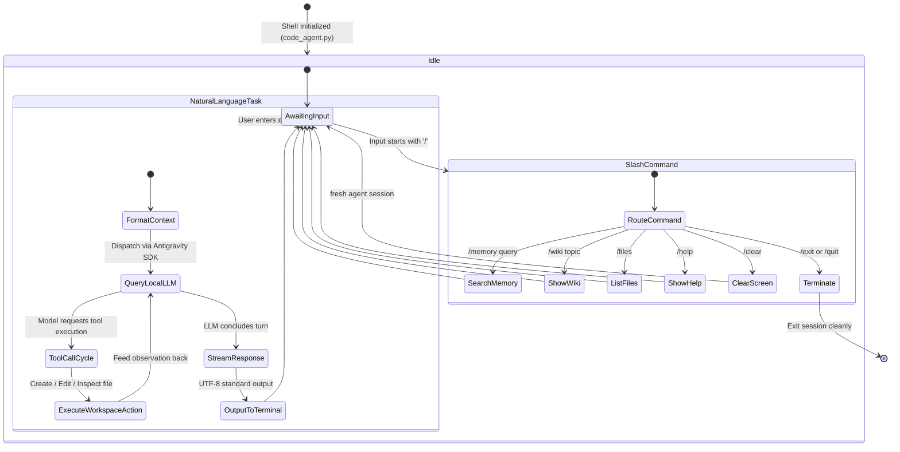
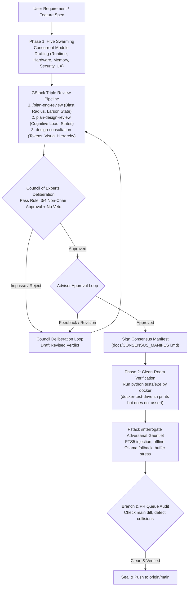
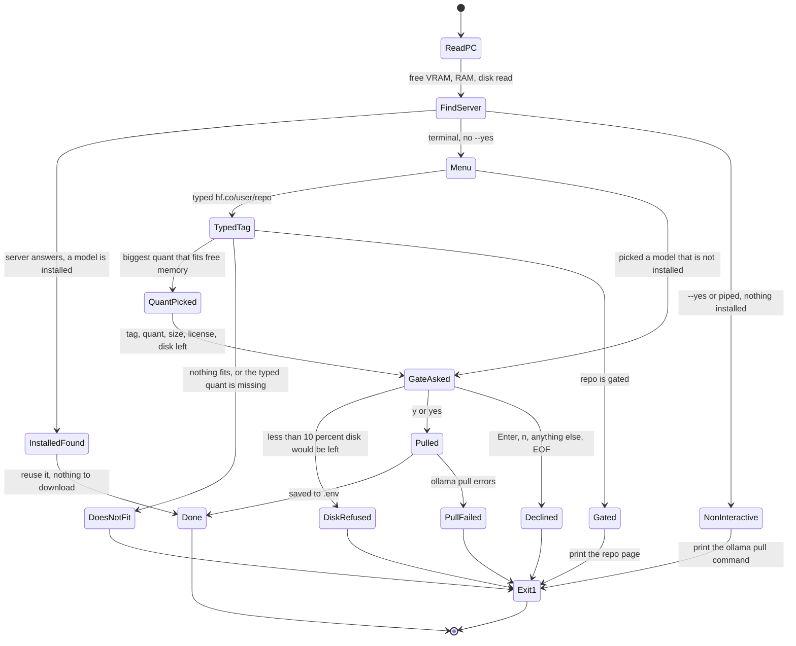
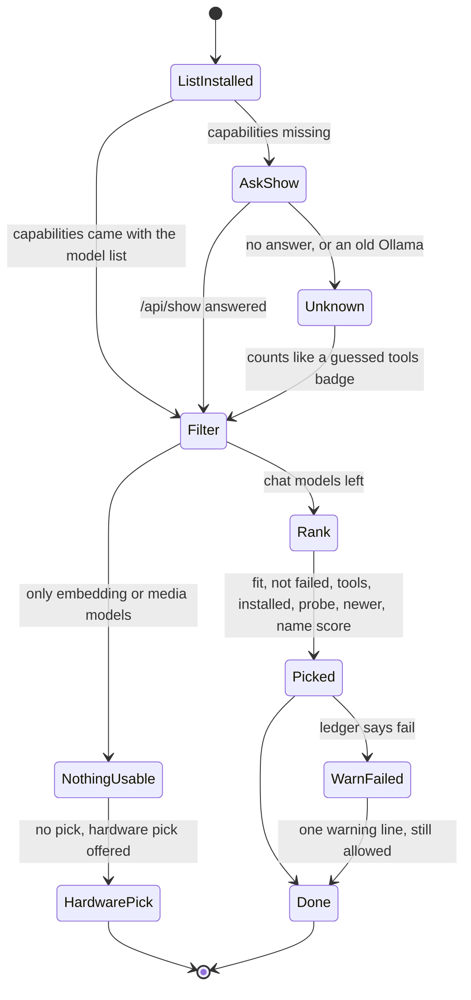
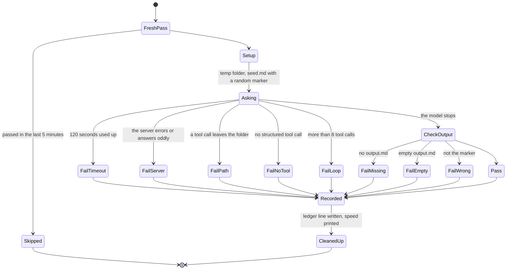
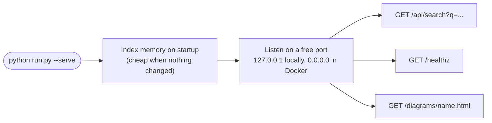

# System Execution Flows & Lifecycles

This document walks through the lifecycle and execution flows of Antigravity Local, step by step. The standalone diagram HTML files are generated and can lag behind this text. The Mermaid blocks here follow the current code.

> Interactive Archify visualizations. Open the standalone HTML files in your browser to zoom, toggle dark/light themes, and trace signals live:
> - [1-Command Bootstrap Workflow (HTML)](diagrams/bootstrap-workflow.html)
> - [Autonomous Tool Execution Sequence (HTML)](diagrams/agent-tool-execution.html)
> - [Model Pre-Check & Capability Selection Pipeline (HTML)](diagrams/model-pipeline-workflow.html)
> - [Overall System Topology Architecture (HTML)](diagrams/system-topology.html)
>
> Live CLI preview:
> ```bash
> # Preview any diagram with live reload in your browser:
> archify preview workflow docs/diagrams/bootstrap-workflow.workflow.json
> archify preview sequence docs/diagrams/agent-tool-execution.sequence.json
> archify preview workflow docs/diagrams/model-pipeline-workflow.workflow.json
> archify preview architecture docs/diagrams/system-topology.architecture.json
> ```
> *(Or open directly in browser: `Start-Process "docs\diagrams\bootstrap-workflow.html"` on Windows)*

---

## Flow 1: one-command bootstrap lifecycle

After you clone the repository and run `run.bat`, `run.sh`, or `run.ps1`, `run.py` takes over and sets up the environment on its own. Plan on a few minutes plus the model download, which is roughly 9 GB for the 14B model.

```mermaid
flowchart TD
    Start(["User executes run.bat / run.sh / run.ps1"]) --> Audit["Phase 1: Hardware Audit<br/>Inspect CPU cores, RAM size, VRAM, and Disk space"]
    
    Audit --> VenvCheck{"Virtualenv exists?<br/>(venv/Scripts or venv/bin)"}
    VenvCheck -- No --> CreateVenv["Create isolated venv via venv module"]
    VenvCheck -- Yes --> PipCheck["Phase 2: Dependency Verification<br/>Check google-antigravity and dotenv"]
    CreateVenv --> PipCheck

    PipCheck --> DepsInstalled{"Dependencies present?"}
    DepsInstalled -- No --> PipInstall["Install requirements.txt via pip"]
    DepsInstalled -- Yes --> DaemonCheck["Phase 3: Which server answers LOCAL_LLM_BASE_URL?<br/>GET /api/tags (Ollama), then GET /v1/models (OpenAI-compatible)"]
    PipInstall --> DaemonCheck

    DaemonCheck --> DaemonRunning{"Which server?"}
    DaemonRunning -- "OpenAI-compatible (LM Studio, llama.cpp, vLLM)" --> OpenAIModels["List the models the server has loaded<br/>--model, .env, the menu, or the top rank picks one<br/>Never downloads. Nothing loaded = exit 1"]
    DaemonRunning -- "None, and a custom URL" --> NoServer(["Exit 1: one line naming the URL"])
    DaemonRunning -- "None, default localhost:11434" --> SpawnOllama["Spawn 'ollama serve' background process<br/>Wait for socket handshake"]
    DaemonRunning -- Ollama --> ModelInventory["Phase 4: Defensive Model Pre-Check<br/>Query /api/tags & 'ollama list'"]
    SpawnOllama --> ModelInventory
    OpenAIModels --> WorkspaceDemo

    ModelInventory --> TermCheck{"Real terminal and no --yes?"}
    TermCheck -- Yes --> ModelMenu["Show model menu<br/>(Enter keeps the pick; Ctrl+C cancels, exit 130)"]
    TermCheck -- No --> ModelFound
    ModelMenu --> ModelFound{"Capable model installed?<br/>(or picked)"}
    ModelFound -- Yes --> ReUseModel["Zero-Download Fast Path:<br/>Select highest-ranked local model"]
    ModelFound -- No --> PullModel["Auto-pull the pick or the model for your hardware<br/>(e.g., qwen2.5-coder:14b)<br/>A new download is saved to .env"]
    PullModel --> ReUseModel

    ReUseModel --> TermAgain{"Real terminal?<br/>(no --yes, piped or CI)"}
    TermAgain -- No --> ReadyLine["Stage 5 LAUNCH is skipped: LEVEL CLEAR box<br/>ends with the Ready: line, then exit. No demo, no chat"]
    TermAgain -- Yes --> WorkspaceDemo["Phase 5: Autonomous Verification Test<br/>Execute agent_with_workspace.py<br/>Generates workspace/index.html"]
    WorkspaceDemo --> LaunchShell["Phase 6: Developer Coding Agent Shell<br/>Interactive REPL via code_agent.py"]
    LaunchShell --> Ready(["Ready to code!"])

    classDef proc fill:#1f2937,stroke:#38bdf8,stroke-width:1px,color:#e0f2fe;
    classDef branch fill:#312e81,stroke:#818cf8,stroke-width:1px,color:#e0e7ff;
    classDef success fill:#064e3b,stroke:#34d399,stroke-width:1px,color:#d1fae5;
    classDef start fill:#111827,stroke:#9ca3af,stroke-width:1px,color:#f3f4f6;

    class Start,Ready start;
    class Audit,CreateVenv,PipCheck,PipInstall,DaemonCheck,SpawnOllama,ModelInventory,ModelMenu,PullModel,ReUseModel,WorkspaceDemo,LaunchShell proc;
    class VenvCheck,DepsInstalled,DaemonRunning,TermCheck,ModelFound branch;
```



### What you can count on
- You never run pip by hand. `run.py` builds the virtualenv and installs packages. You do activate the venv yourself before calling `python code_agent.py` directly.
- Safe to run repeatedly. It skips any step that is already satisfied.
- If the Ollama daemon is down, `run.py` starts it in the background.

---

## Flow 2: model inventory pre-check

To avoid downloading multi-gigabyte models you already have, the system checks the local inventory in two tiers before it pulls anything. Ranking uses `capability_rank_key`, the uncapped raw score, so large models never tie at 100. `get_model_capability_score` caps at 100 for display only. Example (rank score, uncapped): `qwen3.6:27b` 105.1, `qwen2.5-coder:14b` 100.2, `qwen2.5-coder:7b` 98.1, `hf.co/mradermacher/nanbeige4.1-3b-gguf:q4_k_m` 92.9, `qwen2.5:14b` 92.2, `llama3.1:8b` 76.4. Embedding and reranker tags such as `qwen3-embedding:8b` (7.4) rank last. The family base is not the whole score, so Nanbeige does not always rank first.

```mermaid
flowchart LR
    Request["Requested Model / Auto-Detect"] --> RESTCheck["Tier 1: Ollama REST API<br/>GET http://localhost:11434/api/tags"]
    
    RESTCheck --> RESTSuccess{"REST Response OK?"}
    RESTSuccess -- Yes --> ParseTags["Parse tag list<br/>(e.g., ['qwen2.5:14b', 'gemma2:27b'])"]
    RESTSuccess -- No --> CLIFallback["Tier 2: CLI Inspection<br/>Execute 'ollama list'"]
    CLIFallback --> ParseTags

    ParseTags --> Normalize["Normalize Model Tags<br/>Strip ':latest' suffixes & case differences"]
    Normalize --> CandidateScoring["Score local candidates:<br/>family base (2026 families 97, Nanbeige 92, DeepSeek 90, Qwen 2.5 88, ... LLaMA 3.x 74; embed and rerank tags 5)<br/>+ 0.3 per billion parameters (cap 72B)<br/>+ keyword bonuses, ranked uncapped"]

    CandidateScoring --> BestCandidate{"Models exist in local inventory?"}
    BestCandidate -- Yes --> FastPath["Zero-Download Fast Path<br/>Reuse highest-scoring local model<br/>(0s delay, 0 GB downloaded)"]
    BestCandidate -- No --> HWEval["Inspect hardware profile<br/>VRAM and system RAM"]
    HWEval --> PullWeights["Hardware-based pull<br/>Workstation (VRAM 15 GB+, or 8 GB+ with 32 GB RAM): qwen2.5-coder:14b<br/>Mid-tier (VRAM 8 GB+ or RAM 16 GB+): qwen2.5-coder:7b<br/>Otherwise: llama3.2:3b"]
    
    PullWeights --> BindModel["Bind to LocalOpenAIConnectionStrategy"]
    FastPath --> BindModel

    classDef proc fill:#1f2937,stroke:#38bdf8,stroke-width:1px,color:#e0f2fe;
    classDef branch fill:#312e81,stroke:#818cf8,stroke-width:1px,color:#e0e7ff;
    classDef fast fill:#064e3b,stroke:#34d399,stroke-width:1px,color:#d1fae5;

    class Request,RESTCheck,CLIFallback,ParseTags,Normalize,CandidateScoring,PullWeights,BindModel proc;
    class RESTSuccess,BestCandidate branch;
    class FastPath fast;
```



---

## Flow 3: tool-calling loop

When the agent gets a task that changes the workspace, it runs this sequence:

```mermaid
sequenceDiagram
    autonumber
    actor Developer as Developer / CLI
    participant Agent as Antigravity Agent Runtime
    participant Strategy as LocalOpenAI Router
    participant Ollama as Ollama Daemon (:11434)
    participant Policy as Security Policy
    participant Harness as Workspace Harness
    participant Disk as Workspace Filesystem

    Developer->>Agent: task: "Generate modern landing page in index.html"
    Note over Agent: Compiles prompt, system instruction,<br/>and available tool schemas
    Agent->>Strategy: stream_chat(messages, tools=[write_to_file, edit_file])
    Strategy->>Ollama: POST /v1/chat/completions (OpenAI compatible SSE)
    
    activate Ollama
    Note over Ollama: Model infers task requirements<br/>and triggers tool call
    Ollama-->>Strategy: Yield tool_call: write_to_file(TargetFile="index.html", CodeContent="...")
    deactivate Ollama

    Strategy-->>Agent: Dispatched tool invocation
    
    activate Agent
    Agent->>Policy: Intercept tool call: verify permission for write_to_file
    activate Policy
    Policy-->>Agent: policy.allow_all() APPROVED (workspace-scoped)
    deactivate Policy

    Agent->>Harness: invoke write_to_file("index.html", content, Overwrite=True)
    activate Harness
    Harness->>Disk: Write ./workspace/index.html
    Disk-->>Harness: file written
    Harness-->>Agent: Observation: "File index.html created successfully"
    deactivate Harness

    Note over Agent: Evaluates result; determines task is complete
    Agent-->>Developer: "Task complete. Generated modern landing page at workspace/index.html"
    deactivate Agent
```

---

## Flow 4: interactive coding shell (`code_agent.py`)

The coding agent handles one-shot tasks and a continuous conversation. With `--with-memory`, each prompt gets the top 2 memory excerpts (1,200 characters each) prepended. The prompt reads `CodeAgent [You] >`.



---

## Flow 5: review and clean-room verification lifecycle

This is the review process the project used for its first release. It is a process description, not an automated pipeline. CI itself runs the unit tests and `python tests/e2e.py docker`.



---

## Flow 8: fit the model to what is free, and ask before every pull

This is the model-picking part of Flow 1, drawn as a state machine. Two rules drive it. First, models are fitted to the memory that is free right now (a game sitting on your VRAM counts), with 20% headroom. Second, nothing downloads until you type `y`. The `--yes` flag, piped input and CI never download: they use the best installed model, or stop with exit 1 and print the exact `ollama pull` line.



Every transition and the test that covers it:

| Transition | Test |
|---|---|
| ReadPC to FindServer | `tests.test_hardware.FreeVram.test_reads_mib_as_gb`, `tests.test_pull_flow.OllamaServe.test_spawned_serve_listens_on_this_pc_only` |
| FindServer to InstalledFound | `tests.test_pull_flow.NeverDownloads.test_yes_with_an_installed_model_still_just_uses_it` |
| FindServer to Menu | `tests.test_run.ModelWizardInRun.test_picking_a_new_model_pulls_exactly_that_tag` |
| FindServer to NonInteractive | `tests.test_pull_flow.NeverDownloads.test_yes_with_no_installed_model_exits_1_prints_the_command_and_never_pulls`, `test_piped_input_with_no_installed_model_exits_1_and_never_pulls` |
| Menu to TypedTag | `tests.test_run.ModelWizardInRun.test_typed_hf_tag_that_exists_is_pulled_as_typed_and_saved` |
| Menu to GateAsked | `tests.test_run.ModelWizardInRun.test_every_pull_asks_first_even_a_small_one` |
| TypedTag to QuantPicked | `tests.test_run.ModelWizardInRun.test_typed_hf_repo_gets_the_largest_quant_that_fits_free_vram`, `tests.test_quant_pick.PickQuant.test_16gb_free_vram_picks_largest_under_13_3` |
| TypedTag to DoesNotFit | `tests.test_run.ModelWizardInRun.test_typed_hf_quant_the_repo_lacks_downloads_nothing`, `test_typed_hf_repo_where_nothing_fits_downloads_nothing_and_says_why` |
| TypedTag to Gated | `tests.test_run.ModelWizardInRun.test_gated_repo_is_skipped_with_its_page` |
| QuantPicked to GateAsked | `tests.test_run.ModelWizardInRun.test_typed_hf_repo_gets_the_largest_quant_that_fits_free_vram` |
| GateAsked to DiskRefused | `tests.test_run.ModelWizardInRun.test_full_disk_refuses_before_any_pull`, `tests.test_pull_gate` disk tests |
| GateAsked to Pulled | `tests.test_run.ModelWizardInRun.test_only_a_typed_y_downloads` |
| GateAsked to Declined | `test_only_a_typed_y_downloads`, `test_eof_at_the_prompt_downloads_nothing`, `tests.test_pull_flow.NeverDownloads.test_a_terminal_answer_of_n_downloads_nothing_and_exits_1`; Ctrl+C: `test_ctrl_c_at_the_prompt_stops_and_downloads_nothing` |
| Pulled to Done | `tests.test_run.ModelWizardInRun.test_a_newly_downloaded_pick_is_saved_to_env` |
| Pulled to PullFailed | `tests.test_run.ModelWizardInRun.test_a_failed_download_leaves_env_alone` |
| Anything to Exit1 | `tests.test_pull_flow.NeverDownloads` (exit code 1 and no `ollama pull` call), `tests.test_run.PullFailure.test_failed_pull_returns_none_and_main_exits_nonzero` |
| Free memory to fit label | `tests.test_model_wizard.FitLabel` (old total-VRAM cases), `tests.test_quant_pick.PickQuant.test_cpu_only_split_fit` |
| Every printed line to the run log | `tests.test_pull_flow.NeverDownloads.test_every_printed_line_also_lands_in_the_run_log`, `tests.test_runlog.Tee` |
| Server we start is loopback only, a running one is left alone | `tests.test_pull_flow.OllamaServe` |

## Flow 9: pick by what a model can do, and check it with a probe

Models carry badges (`tools`, `thinking`, `vision`, `embedding`, `coding`). Ollama's `/api/show` says for sure; Hugging Face only hints, so those badges keep a `?` until `python run.py --probe` passes. The pick filters out embedding and media models first, then ranks what is left in a fixed order. A model that failed a probe ranks lower but is never refused.





Every transition and the test that covers it:

| Transition | Test |
|---|---|
| ListInstalled to Filter | `tests.test_ollama_models.InstalledDetails.test_capabilities_in_tags_mean_no_show_calls` |
| ListInstalled to AskShow | `tests.test_ollama_models.InstalledDetails.test_missing_capabilities_are_asked_for_once_per_model_with_the_model_key` |
| AskShow to Unknown | `tests.test_ollama_models.InstalledDetails.test_an_old_server_with_no_capabilities_field_is_unknown_not_empty` |
| Unknown to Filter | `tests.test_pick_badges.Ranking.test_unknown_capabilities_from_an_old_ollama_fall_back_to_the_name_score` |
| Filter to NothingUsable | `tests.test_pick_badges.EmbeddingOnly.test_an_embedding_only_install_is_never_picked_and_the_pull_command_is_printed` |
| Filter to Rank | `tests.test_ranking.RankingTable.test_each_level_beats_everything_below_it` |
| Rank (no tools ranks lower) | `tests.test_pick_badges.Ranking.test_a_model_without_tools_ranks_below_one_with_tools_even_with_a_better_name` |
| Rank (ledger fail below unproven) | `tests.test_pick_badges.Ranking.test_a_ledger_fail_ranks_below_unproven` |
| Picked to WarnFailed | `tests.test_pick_badges.Ranking.test_a_model_that_failed_can_still_be_asked_for_and_gets_one_warning_line` |
| WarnFailed to Done (a later pass clears it) | `tests.test_pick_badges.Ranking.test_a_later_pass_clears_the_fail` |
| A configured embedding model is skipped | `tests.test_pick_badges.EmbeddingOnly.test_a_configured_embedding_model_is_ignored_with_a_note` |
| An embedding model named by hand is refused | `tests.test_pick_badges.EmbeddingOnly.test_asking_for_an_embedding_model_by_name_is_refused` |
| FreshPass to Skipped | `tests.test_pick_badges.ProbeCommand.test_a_pass_from_the_last_five_minutes_is_not_repeated` |
| FreshPass to Setup, Setup to Asking | `tests.test_probe.Probe.test_seed_md_holds_exactly_marker_equals_128_bits_of_hex_and_no_newline`, `test_the_request_is_a_non_streaming_chat_with_both_tools_to_the_v1_endpoint` |
| Asking to FailTimeout | `tests.test_probe.Probe.test_running_out_of_time_fails_with_a_timeout` |
| Asking to FailServer | `tests.test_probe.Probe.test_a_server_that_errors_fails_with_the_server_reason` |
| Asking to FailPath | `tests.test_probe.Probe.test_a_path_outside_the_folder_fails_before_anything_else_and_is_never_run` |
| Asking to FailNoTool | `tests.test_probe.Probe.test_no_structured_tool_call_fails_even_if_the_text_looks_like_one` |
| Asking to FailLoop | `tests.test_probe.Probe.test_more_than_eight_tool_calls_is_a_loop` |
| CheckOutput to FailMissing, FailEmpty, FailWrong | `tests.test_probe.Probe.test_output_md_missing_fails`, `test_output_md_empty_fails`, `test_output_md_with_the_wrong_content_fails` |
| CheckOutput to Pass | `tests.test_probe.Probe.test_a_model_that_reads_and_writes_the_marker_through_tools_passes` |
| Any verdict to Recorded | `tests.test_pick_badges.ProbeCommand.test_a_pass_is_recorded_and_exits_zero`, `test_a_fail_is_recorded_exits_one_and_a_slow_model_is_called_slow` |
| Recorded to CleanedUp | `tests.test_probe.Probe.test_the_temp_folder_is_removed_after_a_pass_a_fail_and_a_server_error` |
| Speed (slow under 5 tok/s, silent with no counts) | `tests.test_probe.Probe.test_tokens_per_second_is_completion_tokens_over_elapsed_rounded_to_a_tenth`, `tests.test_pick_badges.ProbeCommand.test_no_token_count_prints_nothing_about_speed` |
| The marker never leaks | `tests.test_probe.Probe.test_no_reason_ever_contains_the_marker_even_if_the_model_echoes_it` |
| Hugging Face search from the menu | `tests.test_model_wizard.HfSearchAtTheMenu.test_words_are_searched_and_a_pick_becomes_an_hf_tag`, `tests.test_pick_badges.MenuRows.test_typing_words_at_the_hf_row_searches_and_a_pick_goes_through_the_download_gate` |
| Cache fresh for 24 hours, then expired | `tests.test_hf_search.Cache.test_second_call_inside_24h_never_touches_the_network`, `test_cache_expires_at_24h` |
| Busy Hub (429) waited out, then give up | `tests.test_hf_search.Backoff` |
| Offline gives one warning line | `tests.test_pick_badges.Offline.test_hugging_face_unreachable_warns_exactly_once_for_the_whole_run` |
| Media rows behind their own row, never picked, never a bad try | `tests.test_model_wizard.MediaSection.test_media_pick_then_a_number_then_enter_keeps_the_default_with_no_bad_try`, `tests.test_pick_badges.MediaAndLibrary` |
| Badge mapping per source | `tests.test_capabilities.OllamaBadges`, `HfBadges`, `Catalog` |

## Summary of flow triggers

| Action | Command / Trigger | Primary Module | Visual Architecture Ref |
|---|---|---|---|
| **Turnkey Bootstrap** | `run.bat` / `run.sh` / `run.ps1` | `run.py` | [Bootstrap Workflow](diagrams/bootstrap-workflow.html) |
| **Interactive Coding Shell** | `python code_agent.py` | `code_agent.py` | [Tool Execution Sequence](diagrams/agent-tool-execution.html) |
| **Memory-Augmented Coding** | `python code_agent.py --with-memory` | `code_agent.py` | [System Topology](diagrams/system-topology.html) |
| **Hybrid Memory Search** | `python memory.py search "<query>"` | `memory.py` | [System Topology](diagrams/system-topology.html) |
| **Dual-Sync AST & Memory** | `python memory.py sync` | `memory.py` | [System Topology](diagrams/system-topology.html) |
| **Clean-Room Docker Test** | `python tests/e2e.py docker` | `tests/e2e.py` | [System Topology](diagrams/system-topology.html) |
| **Memory Web App** | `python run.py --serve` | `serve.py` | [System Topology](diagrams/system-topology.html) |
| **One-Shot Task Execution** | `python code_agent.py --task "<task>"` | `code_agent.py` | [Tool Execution Sequence](diagrams/agent-tool-execution.html) |
| **Play the setup as a game** | Open `/game/` on the project site | `site/public/game/index.html` | [System Topology](diagrams/system-topology.html) |
| **Model Pre-Flight & Pull** | Built into `run.py` | `run.py:get_installed_ollama_models()` | [Model Selection Pipeline](diagrams/model-pipeline-workflow.html) |
| **Streaming Token Test** | `python test_local.py [model]` | `test_local.py` | [System Topology](diagrams/system-topology.html) |
| **Autonomous Workspace Demo** | `python agent_with_workspace.py [model]`| `agent_with_workspace.py` | [Tool Execution Sequence](diagrams/agent-tool-execution.html) |

---

## Flow 6: memory web app (`serve.py`)

`python run.py --serve` (or the Docker image) starts a small web server. It indexes the memory fabric when it starts, then answers search requests.



The server has no authentication. Keep it on `127.0.0.1`, or publish the Docker port with `-p 127.0.0.1::8000`. It does not need Ollama. Without it, search uses the built-in fallback vectors. The local path builds its own venv on first run.

---

## Flow 7: the project site and the zero-to-coding game

The GitHub Pages site (`site/`, Vite) is documentation, not a runtime path. It is built with `npm run build` and published from `site/dist`. The game is a static page at `site/public/game/index.html`, served at `/game/` and linked from the homepage hero, nav, game section, and footer.

The game walks the same nine steps as Flow 1, as a side-scroller: run the launcher, pull Ollama, pull `qwen2.5-coder:14b`, serve on `:11434`, wire the endpoint for the Antigravity Harness, start the Agent, watch the Agent call Ollama and receive a `tool_call`, write a file through the Policy Gate, and land in Memory + Editor with a Hello World in the IDE. Each station is guarded by the system it sets up, and clearing it collects that system's tool into a pocket that fills to POCKET FULL. The game runs no Ollama, pulls no model, and writes no files. To actually set up, follow Flow 1.

One publishing rule to remember: Vite copies `site/public/` verbatim into `site/dist`. A page placed directly under `site/` is not published. That is why the game 404'd when it was first added at `site/game/index.html`, and why it lives in `site/public/game/` now.

## Setup stages and the LEVEL CLEAR summary

Setup prints five stages: ENVIRONMENT, SERVER, MODEL, CONTEXT and LAUNCH. Each stage has a banner (`STAGE 2/5  SERVER`), a progress bar and what happens next, all on one line. When setup finishes, the LEVEL CLEAR box is followed by a short "Use <model> in a coding app" block (`python run.py --coding-apps` prints it alone; steps are in `docs/coding-apps.md`). The CONTEXT stage says the window the model really runs with, in this order: the loaded model (`/api/ps`), the model's own `num_ctx` (`/api/show`), `OLLAMA_CONTEXT_LENGTH`, then Ollama's default for your graphics memory. It then picks the largest rung (8K, 16K, 32K, 64K, written as at most 64,000) whose KV cache fits in free GPU memory after the weights x 1.2, and says one of: that covers it, the model can go no higher, there is no room for 8K (use `/steps`), or coding agents want that target. In that last case it asks once (y/N) to make a copy with that window (`ollama create <tag>-ctx16k` from a two-line Modelfile, `FROM <tag>` and `PARAMETER num_ctx`). The copy reuses the weights and never pulls. A yes switches the run to the copy and saves it as `LOCAL_LLM_MODEL`; a no or end of input changes nothing and the offer comes back next start. It prints no restart command. After the banner it asks once (y/N) to add a VS Code Chat model entry with the real window, and only when Ollama reported that window. Without a yes, nothing is written. It never changes Ollama. When setup finishes, a LEVEL CLEAR box shows the model, its size, where it came from (installed or pulled), the agent and the log path. A run with no terminal (`--yes`, piped input or CI) ends the box with the `Ready:` line and never starts the agent. `--plain` or `NO_COLOR` turns off the art and the bar blocks. In the shell, a typed prompt over that window (`checkpoint.tokens`) is never cut: it prints `Over the <window> window, so the model may forget the start.` and asks `Send anyway? [Y/n] (or type /steps)`. Enter, `y` or `yes` sends it unchanged; `n`, `no` or end of input prints `Not sent. Nothing was cut, and the model was not changed.`; `/steps` runs step mode with the prompt as its task.
