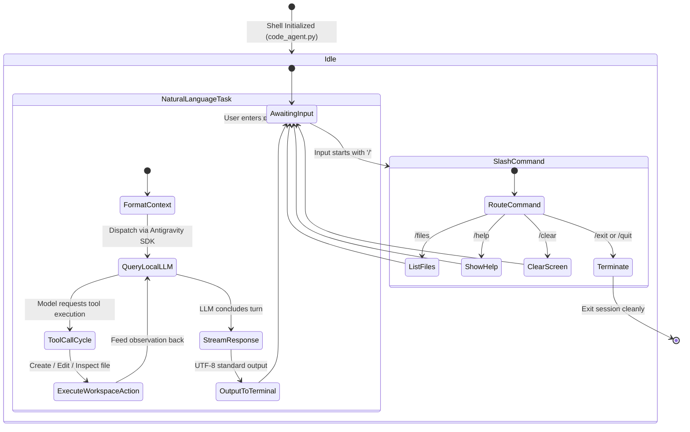

# System Execution Flows & Lifecycles

This document provides detailed step-by-step lifecycle specifications and execution flows for **Antigravity Local**.

> **Interactive Archify Visualizations**: Open the standalone interactive HTML files in your browser for smooth zoom, dark/light toggle, and live signal tracing:
> - 🚀 [**1-Command Bootstrap Workflow (HTML)**](diagrams/bootstrap-workflow.html)
> - ⚡ [**Autonomous Tool Execution Sequence (HTML)**](diagrams/agent-tool-execution.html)
> - 🧠 [**Model Pre-Check & Capability Selection Pipeline (HTML)**](diagrams/model-pipeline-workflow.html)
> - 🏛️ [**Overall System Topology Architecture (HTML)**](diagrams/system-topology.html)

---

## Flow 1: 1-Command Plug-and-Play Bootstrap Lifecycle

When a user clones the repository and executes `run.bat`, `run.sh`, or `run.ps1`, `run.py` takes over to autonomously provision the complete environment.

```mermaid
flowchart TD
    Start(["User executes run.bat / run.sh / run.ps1"]) --> Audit["Phase 1: Hardware Audit<br/>Inspect CPU cores, RAM size, VRAM, and Disk space"]
    
    Audit --> VenvCheck{"Virtualenv exists?<br/>(venv/Scripts or venv/bin)"}
    VenvCheck -- No --> CreateVenv["Create isolated venv via venv module"]
    VenvCheck -- Yes --> PipCheck["Phase 2: Dependency Verification<br/>Check google-antigravity and dotenv"]
    CreateVenv --> PipCheck

    PipCheck --> DepsInstalled{"Dependencies present?"}
    DepsInstalled -- No --> PipInstall["Install requirements.txt via pip"]
    DepsInstalled -- Yes --> DaemonCheck["Phase 3: Ollama Daemon Health Check<br/>GET http://localhost:11434/api/tags"]
    PipInstall --> DaemonCheck

    DaemonCheck --> DaemonRunning{"Ollama online?"}
    DaemonRunning -- No --> SpawnOllama["Spawn 'ollama serve' background process<br/>Wait for socket handshake"]
    DaemonRunning -- Yes --> ModelInventory["Phase 4: Defensive Model Pre-Check<br/>Query /api/tags & 'ollama list'"]
    SpawnOllama --> ModelInventory

    ModelInventory --> ModelFound{"Capable model installed?<br/>(Nanbeige / Qwen / Gemma)"}
    ModelFound -- Yes --> ReUseModel["Zero-Download Fast Path:<br/>Select highest-scoring local model"]
    ModelFound -- No --> PullModel["Auto-pull recommended model<br/>(e.g., qwen2.5:14b)"]
    PullModel --> ReUseModel

    ReUseModel --> WorkspaceDemo["Phase 5: Autonomous Verification Test<br/>Execute agent_with_workspace.py<br/>Generates workspace/index.html"]
    WorkspaceDemo --> LaunchShell["Phase 6: Developer Coding Agent Shell<br/>Interactive REPL via code_agent.py"]
    LaunchShell --> Ready(["Ready to code!"])

    classDef proc fill:#1f2937,stroke:#38bdf8,stroke-width:1px,color:#e0f2fe;
    classDef branch fill:#312e81,stroke:#818cf8,stroke-width:1px,color:#e0e7ff;
    classDef success fill:#064e3b,stroke:#34d399,stroke-width:1px,color:#d1fae5;
    classDef start fill:#111827,stroke:#9ca3af,stroke-width:1px,color:#f3f4f6;

    class Start,Ready start;
    class Audit,CreateVenv,PipCheck,PipInstall,DaemonCheck,SpawnOllama,ModelInventory,PullModel,ReUseModel,WorkspaceDemo,LaunchShell proc;
    class VenvCheck,DepsInstalled,DaemonRunning,ModelFound branch;
```



### Key Guarantees:
- **Zero Configuration**: No manual virtualenv activation or pip commands required.
- **Idempotent**: Safe to run repeatedly; skips any step already satisfied.
- **Self-Healing**: If Ollama daemon is down, automatically starts it in the background.

---

## Flow 2: Zero-Redundant Model Inventory Pre-Check Pipeline

To prevent downloading multi-gigabyte models when weights are already present locally, the system uses a dual-tier pre-flight inventory inspection:

```mermaid
flowchart LR
    Request["Requested Model / Auto-Detect"] --> RESTCheck["Tier 1: Ollama REST API<br/>GET http://localhost:11434/api/tags"]
    
    RESTCheck --> RESTSuccess{"REST Response OK?"}
    RESTSuccess -- Yes --> ParseTags["Parse tag list<br/>(e.g., ['qwen2.5:14b', 'gemma2:27b'])"]
    RESTSuccess -- No --> CLIFallback["Tier 2: CLI Inspection<br/>Execute 'ollama list'"]
    CLIFallback --> ParseTags

    ParseTags --> Normalize["Normalize Model Tags<br/>Strip ':latest' suffixes & case differences"]
    Normalize --> CandidateScoring["Score Local Candidates:<br/>1. Nanbeige: 85 pts<br/>2. Qwen 2.5: 80 pts<br/>3. DeepSeek Coder: 78 pts<br/>4. Codestral: 75 pts<br/>5. Gemma 2: 70 pts<br/>6. LLaMA 3.1: 65 pts"]

    CandidateScoring --> BestCandidate{"Best local candidate found?"}
    BestCandidate -- Yes --> FastPath["Zero-Download Fast Path<br/>Reuse local weights instantly<br/>(0s delay, 0 GB downloaded)"]
    BestCandidate -- No --> PullWeights["Targeted Download<br/>ollama pull <model>"]
    
    PullWeights --> BindModel["Bind to LocalOpenAIConnectionStrategy"]
    FastPath --> BindModel

    classDef proc fill:#1f2937,stroke:#38bdf8,stroke-width:1px,color:#e0f2fe;
    classDef branch fill:#312e81,stroke:#818cf8,stroke-width:1px,color:#e0e7ff;
    classDef fast fill:#064e3b,stroke:#34d399,stroke-width:1px,color:#d1fae5;

    class Request,RESTCheck,CLIFallback,ParseTags,Normalize,CandidateScoring,PullWeights,BindModel proc;
    class RESTSuccess,BestCandidate branch;
    class FastPath fast;
```



---

## Flow 3: Autonomous Tool-Calling Execution Sequence Loop

When the agent receives a task requiring workspace modifications, it executes the following sequence:

```mermaid
sequenceDiagram
    autonumber
    actor Developer as Developer / CLI
    participant Agent as Antigravity Agent Runtime
    participant Strategy as LocalOpenAI Router
    participant Ollama as Ollama Daemon (:11434)
    participant Policy as Security Policy
    participant Harness as Workspace Harness
    participant Disk as Workspace Filesystem

    Developer->>Agent: task: "Generate modern landing page in index.html"
    Note over Agent: Compiles prompt, system instruction,<br/>and available tool schemas
    Agent->>Strategy: stream_chat(messages, tools=[create_file, edit_file])
    Strategy->>Ollama: POST /v1/chat/completions (OpenAI compatible SSE)
    
    activate Ollama
    Note over Ollama: Model infers task requirements<br/>and triggers tool call
    Ollama-->>Strategy: Yield tool_call: create_file(path="index.html", content="...")
    deactivate Ollama

    Strategy-->>Agent: Dispatched tool invocation
    
    activate Agent
    Agent->>Policy: Intercept tool call: verify permission for create_file
    activate Policy
    Policy-->>Agent: policy.allow_all() APPROVED (workspace-scoped)
    deactivate Policy

    Agent->>Harness: invoke create_file("index.html", content, overwrite=True)
    activate Harness
    Harness->>Disk: Write ./workspace/index.html
    Disk-->>Harness: 3,420 bytes written successfully
    Harness-->>Agent: Observation: "File index.html created successfully"
    deactivate Harness

    Note over Agent: Evaluates result; determines task is complete
    Agent-->>Developer: "Task complete. Generated modern landing page at workspace/index.html"
    deactivate Agent
```

---

## Flow 4: Interactive Coding Agent Shell Flow (`code_agent.py`)

The developer coding agent provides both one-shot task execution and a continuous conversational pair-programming loop:



---

## 5. Summary Matrix of Flow Triggers

| Action | Command / Trigger | Primary Module | Visual Architecture Ref |
|---|---|---|---|
| **Turnkey Bootstrap** | `run.bat` / `run.sh` / `run.ps1` | `run.py` | [Bootstrap Workflow](diagrams/bootstrap-workflow.html) |
| **Interactive Coding Shell** | `python code_agent.py` | `code_agent.py` | [Tool Execution Sequence](diagrams/agent-tool-execution.html) |
| **One-Shot Task Execution** | `python code_agent.py --task "<task>"` | `code_agent.py` | [Tool Execution Sequence](diagrams/agent-tool-execution.html) |
| **Model Pre-Flight & Pull** | Built into `run.py` | `run.py:get_installed_ollama_models()` | [Model Selection Pipeline](diagrams/model-pipeline-workflow.html) |
| **Streaming Token Test** | `python test_local.py [model]` | `test_local.py` | [System Topology](diagrams/system-topology.html) |
| **Autonomous Workspace Demo** | `python agent_with_workspace.py [model]`| `agent_with_workspace.py` | [Tool Execution Sequence](diagrams/agent-tool-execution.html) |
