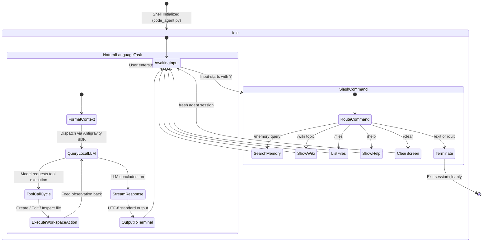
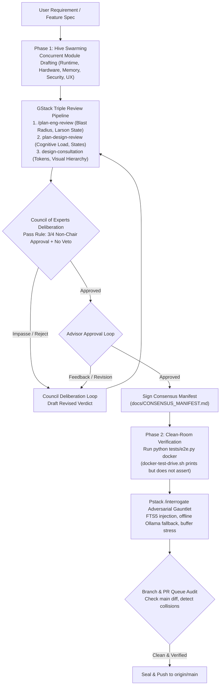
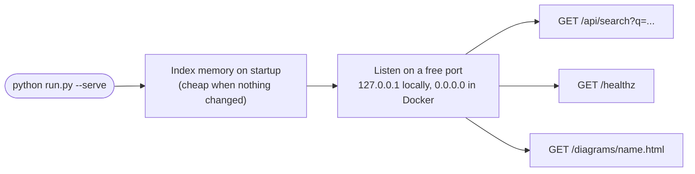

# System Execution Flows & Lifecycles

This document walks through the lifecycle and execution flows of Antigravity Local, step by step. The standalone diagram HTML files are generated and can lag behind this text. The Mermaid blocks here follow the current code.

> Interactive Archify visualizations. Open the standalone HTML files in your browser to zoom, toggle dark/light themes, and trace signals live:
> - [1-Command Bootstrap Workflow (HTML)](diagrams/bootstrap-workflow.html)
> - [Autonomous Tool Execution Sequence (HTML)](diagrams/agent-tool-execution.html)
> - [Model Pre-Check & Capability Selection Pipeline (HTML)](diagrams/model-pipeline-workflow.html)
> - [Overall System Topology Architecture (HTML)](diagrams/system-topology.html)
>
> Live CLI preview:
> ```bash
> # Preview any diagram with live reload in your browser:
> archify preview workflow docs/diagrams/bootstrap-workflow.workflow.json
> archify preview sequence docs/diagrams/agent-tool-execution.sequence.json
> archify preview workflow docs/diagrams/model-pipeline-workflow.workflow.json
> archify preview architecture docs/diagrams/system-topology.architecture.json
> ```
> *(Or open directly in browser: `Start-Process "docs\diagrams\bootstrap-workflow.html"` on Windows)*

---

## Flow 1: one-command bootstrap lifecycle

After you clone the repository and run `run.bat`, `run.sh`, or `run.ps1`, `run.py` takes over and sets up the environment on its own. Plan on a few minutes plus the model download, which is roughly 9 GB for the 14B model.


### What you can count on
- You never run pip by hand. `run.py` builds the virtualenv and installs packages. You do activate the venv yourself before calling `python code_agent.py` directly.
- Safe to run repeatedly. It skips any step that is already satisfied.
- If the Ollama daemon is down, `run.py` starts it in the background.

---

## Flow 2: model inventory pre-check

To avoid downloading multi-gigabyte models you already have, the system checks the local inventory in two tiers before it pulls anything. Ranking uses `get_model_capability_score`, which caps at 100, so several large coder models tie at the top. Example scores: `nanbeige4.1:3b` 92.9, `qwen2.5:14b` 92.2, `qwen2.5-coder:7b` 98.1, `llama3.1:8b` 76.4. The family base is not the whole score, so Nanbeige does not always rank first.

```mermaid
flowchart LR
    Request["Requested Model / Auto-Detect"] --> RESTCheck["Tier 1: Ollama REST API<br/>GET http://localhost:11434/api/tags"]
    
    RESTCheck --> RESTSuccess{"REST Response OK?"}
    RESTSuccess -- Yes --> ParseTags["Parse tag list<br/>(e.g., ['qwen2.5:14b', 'gemma2:27b'])"]
    RESTSuccess -- No --> CLIFallback["Tier 2: CLI Inspection<br/>Execute 'ollama list'"]
    CLIFallback --> ParseTags

    ParseTags --> Normalize["Normalize Model Tags<br/>Strip ':latest' suffixes & case differences"]
    Normalize --> CandidateScoring["Score local candidates:<br/>family base (Nanbeige 92, DeepSeek 90, Qwen 2.5 88, ... LLaMA 3.x 74)<br/>+ 0.3 per billion parameters (cap 72B)<br/>+ keyword bonuses, total capped at 100"]

    CandidateScoring --> BestCandidate{"Models exist in local inventory?"}
    BestCandidate -- Yes --> FastPath["Zero-Download Fast Path<br/>Reuse highest-scoring local model<br/>(0s delay, 0 GB downloaded)"]
    BestCandidate -- No --> HWEval["Inspect hardware profile<br/>VRAM and system RAM"]
    HWEval --> PullWeights["Hardware-based pull<br/>Workstation (VRAM 15 GB+, or 8 GB+ with 32 GB RAM): qwen2.5-coder:14b<br/>Mid-tier (VRAM 8 GB+ or RAM 16 GB+): qwen2.5-coder:7b<br/>Otherwise: llama3.2:3b"]
    
    PullWeights --> BindModel["Bind to LocalOpenAIConnectionStrategy"]
    FastPath --> BindModel

    classDef proc fill:#1f2937,stroke:#38bdf8,stroke-width:1px,color:#e0f2fe;
    classDef branch fill:#312e81,stroke:#818cf8,stroke-width:1px,color:#e0e7ff;
    classDef fast fill:#064e3b,stroke:#34d399,stroke-width:1px,color:#d1fae5;

    class Request,RESTCheck,CLIFallback,ParseTags,Normalize,CandidateScoring,PullWeights,BindModel proc;
    class RESTSuccess,BestCandidate branch;
    class FastPath fast;
```



---

## Flow 3: tool-calling loop

When the agent gets a task that changes the workspace, it runs this sequence:

```mermaid
sequenceDiagram
    autonumber
    actor Developer as Developer / CLI
    participant Agent as Antigravity Agent Runtime
    participant Strategy as LocalOpenAI Router
    participant Ollama as Ollama Daemon (:11434)
    participant Policy as Security Policy
    participant Harness as Workspace Harness
    participant Disk as Workspace Filesystem

    Developer->>Agent: task: "Generate modern landing page in index.html"
    Note over Agent: Compiles prompt, system instruction,<br/>and available tool schemas
    Agent->>Strategy: stream_chat(messages, tools=[create_file, edit_file])
    Strategy->>Ollama: POST /v1/chat/completions (OpenAI compatible SSE)
    
    activate Ollama
    Note over Ollama: Model infers task requirements<br/>and triggers tool call
    Ollama-->>Strategy: Yield tool_call: create_file(path="index.html", content="...")
    deactivate Ollama

    Strategy-->>Agent: Dispatched tool invocation
    
    activate Agent
    Agent->>Policy: Intercept tool call: verify permission for create_file
    activate Policy
    Policy-->>Agent: policy.allow_all() APPROVED (workspace-scoped)
    deactivate Policy

    Agent->>Harness: invoke create_file("index.html", content, overwrite=True)
    activate Harness
    Harness->>Disk: Write ./workspace/index.html
    Disk-->>Harness: file written
    Harness-->>Agent: Observation: "File index.html created successfully"
    deactivate Harness

    Note over Agent: Evaluates result; determines task is complete
    Agent-->>Developer: "Task complete. Generated modern landing page at workspace/index.html"
    deactivate Agent
```

---

## Flow 4: interactive coding shell (`code_agent.py`)

The coding agent handles one-shot tasks and a continuous conversation. With `--with-memory`, each prompt gets the top 2 memory excerpts (1,200 characters each) prepended. The prompt reads `CodeAgent [You] >`.



---

## Flow 5: review and clean-room verification lifecycle

This is the review process the project used for its first release. It is a process description, not an automated pipeline. CI itself runs the unit tests and `python tests/e2e.py docker`.



---

## Summary of flow triggers

| Action | Command / Trigger | Primary Module | Visual Architecture Ref |
|---|---|---|---|
| **Turnkey Bootstrap** | `run.bat` / `run.sh` / `run.ps1` | `run.py` | [Bootstrap Workflow](diagrams/bootstrap-workflow.html) |
| **Interactive Coding Shell** | `python code_agent.py` | `code_agent.py` | [Tool Execution Sequence](diagrams/agent-tool-execution.html) |
| **Memory-Augmented Coding** | `python code_agent.py --with-memory` | `code_agent.py` | [System Topology](diagrams/system-topology.html) |
| **Hybrid Memory Search** | `python memory.py search "<query>"` | `memory.py` | [System Topology](diagrams/system-topology.html) |
| **Dual-Sync AST & Memory** | `python memory.py sync` | `memory.py` | [System Topology](diagrams/system-topology.html) |
| **Clean-Room Docker Test** | `python tests/e2e.py docker` | `tests/e2e.py` | [System Topology](diagrams/system-topology.html) |
| **Memory Web App** | `python run.py --serve` | `serve.py` | [System Topology](diagrams/system-topology.html) |
| **One-Shot Task Execution** | `python code_agent.py --task "<task>"` | `code_agent.py` | [Tool Execution Sequence](diagrams/agent-tool-execution.html) |
| **Play the setup as a game** | Open `/game/` on the project site | `site/public/game/index.html` | [System Topology](diagrams/system-topology.html) |
| **Model Pre-Flight & Pull** | Built into `run.py` | `run.py:get_installed_ollama_models()` | [Model Selection Pipeline](diagrams/model-pipeline-workflow.html) |
| **Streaming Token Test** | `python test_local.py [model]` | `test_local.py` | [System Topology](diagrams/system-topology.html) |
| **Autonomous Workspace Demo** | `python agent_with_workspace.py [model]`| `agent_with_workspace.py` | [Tool Execution Sequence](diagrams/agent-tool-execution.html) |

---

## Flow 6: memory web app (`serve.py`)

`python run.py --serve` (or the Docker image) starts a small web server. It indexes the memory fabric when it starts, then answers search requests.



The server has no authentication. Keep it on `127.0.0.1`, or publish the Docker port with `-p 127.0.0.1::8000`. It does not need Ollama. Without it, search uses the built-in fallback vectors. The local path builds its own venv on first run.

---

## Flow 7: the project site and the zero-to-coding game

The GitHub Pages site (`site/`, Vite) is documentation, not a runtime path. It is built with `npm run build` and published from `site/dist`. The game is a static page at `site/public/game/index.html`, served at `/game/` and linked from the homepage hero, nav, game section, and footer.

The game walks the same nine steps as Flow 1, as a side-scroller: run the launcher, pull Ollama, pull `qwen2.5-coder:14b`, serve on `:11434`, wire the endpoint for the Antigravity Harness, start the Agent, watch the Agent call Ollama and receive a `tool_call`, write a file through the Policy Gate, and land in Memory + Editor with a Hello World in the IDE. Each station is guarded by the system it sets up, and clearing it collects that system's tool into a pocket that fills to POCKET FULL. The game runs no Ollama, pulls no model, and writes no files — to actually set up, follow Flow 1.

One publishing rule to remember: Vite copies `site/public/` verbatim into `site/dist`. A page placed directly under `site/` is not published. That is why the game 404'd when it was first added at `site/game/index.html`, and why it lives in `site/public/game/` now.
