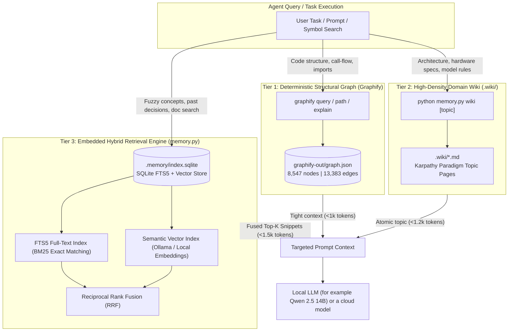

# Memory architecture specification: three-tier memory fabric
## Graphify (AST OKF) + LLMWiki (Karpathy paradigm) + embedded hybrid SQLite engine

> Status: implemented. Graphify is not part of the runtime agent path. Only `python memory.py sync` calls it.  
> Philosophy: one command to set up, local inference, no external daemons, few tokens per query.

---

## 1. Summary and design rationale

When you run local autonomous coding agents (such as Qwen 2.5 14B via Ollama) alongside cloud IDE models (Antigravity Gemini / Claude), the hardest engineering problem is keeping context across sessions without overflowing the model's context window.

A typical codebase contains hundreds of thousands of tokens. Putting raw files into prompts burns tokens fast (e.g., 280,000 tokens per prompt). That causes three problems:
1. Context exhaustion: Prompts exceed context windows (e.g. 32k or 128k tokens).
2. "Needle-in-a-Haystack" Degradation: Reasoning accuracy drops as prompt size increases.
3. Local inference latency: Local models see long time-to-first-token (TTFT) delays when processing 50k+ input tokens on consumer or workstation GPUs.

### The Architectural Question: RAG vs. OKF vs. Vector DB vs. LLMWiki

| Dimension | Standalone Vector DB (Milvus, Qdrant, Chroma) | Traditional Naive RAG (Vector-only) | OKF / Knowledge Graph (Graphify) | LLMWiki (Karpathy Paradigm) | **Our 3-Tier Fabric (Graphify + LLMWiki + SQLite Hybrid)** |
| :--- | :--- | :--- | :--- | :--- | :--- |
| **External Dependencies** | Requires Docker, C++ binaries, or external daemon ports (6333, 8000, 19530). | Moderate to High (vector libraries, API keys). | Zero (local Python CLI, Tree-sitter AST parser). | Zero (pure Markdown repository files). | Zero (built into Python standard library `sqlite3` + Markdown + local AST). |
| **Code Structure Accuracy** | Poor (treats code as generic unstructured prose chunks). | Poor (misses call graphs, inheritance, module boundaries). | 100% Deterministic (extracts exact functions, calls, classes). | High (human/agent curated domain knowledge). | Deterministic AST + Curated Domain Truth + Fuzzy Semantic Retrieval. |
| **Exact Symbol Search (BM25)** | Weak (vector embeddings struggle with exact token hits like `get_hardware_profile`). | Missing or secondary. | Indirect (AST node lookup). | Fast (grep / markdown file reading). | Built-in FTS5 BM25 with rank scoring. |
| **Semantic / Fuzzy Search** | Strong. | Strong. | Weak (relationship-based only). | Moderate (topic navigation). | Dual-engine. Local Ollama embedding with fallback cosine similarity. |
| **Token Consumption** | High (dumps multi-chunk text snippets into prompt). | High (8,000–30,000 tokens per query). | Zero tokens to build; ~800 tokens to query (up to 128x reduction). | Ultra-Low (curated 500–1,500 token atomic pages). | Ultra-Low (<1,200 tokens loaded per targeted action). |
| **Plug & Play Ethos** | Breaks 1-command bootstrap. | Fragile setup. | Native CLI & rules. | Native Git files. | 100% 1-Command Plug & Play. |

---

## 2. The 3-Tier Memory Fabric Architecture

Instead of a heavy vector database that breaks the 1-command plug-and-play promise, this repository uses a 3-tier memory fabric:



---

## 3. Tier specifications

### Tier 1: Graphify (AST Code Knowledge Graph)
- Location: `graphify-out/graph.json` and `.agents/rules/graphify.md`
- Purpose: Answer structural code questions directly from the AST graph, with no hallucination and no wasted tokens.
- How it works: Tree-sitter parses the repository's Python, Bash, HTML, and Markdown files into an AST graph. Nodes represent files, functions, classes, and environment variables; edges represent imports, calls, and file containment.
- Commands:
  - `graphify query "<question>"`: Returns a small, bounded subgraph.
  - `graphify path "<node_A>" "<node_B>"`: Returns exact call-chain or dependency path.
  - `graphify explain "<concept>"`: Explains community cluster connections.
  - `graphify update .`: Syncs the graph after local code changes, at no API cost.
- Measured: Graphify's own report cites a 31.1x to 128.8x token reduction against reading full files. We did not re-measure it. Current graph size: 8,547 nodes, 13,383 edges, 591 communities.

### Tier 2: LLMWiki (Karpathy Concept Pages)
- Location: `.wiki/`
- Purpose: Keep Markdown files, curated by humans and the LLM, as the project's single source of truth for concepts.
- Concept Anatomy:
  - Each wiki file is atomic (500–1,500 tokens) and has headings, bulleted invariants, and cross-references.
  - Models read one `.wiki/<topic>.md` file in a single tool call instead of dozens of documentation pages.
- Core Topics:
  1. `index.md`: Master topic registry and cross-reference table.
  2. `architecture.md`: Local decoupled runtime, harness connection, and air-gapped guarantees.
  3. `hardware-matrix.md`: How GPU VRAM offloading works (written around one example machine, a 16 GB GPU with 128 GB RAM).
  4. `model-hierarchy.md`: Model capability scoring and zero-download logic. See the [product spec](PRODUCT_SPEC.md#module-2-hardware-aware-model-selection) for the real formula.
  5. `tool-execution.md`: Antigravity SDK workspace tool schemas and safety policy enforcement.
  6. `token-optimization.md`: Token costs, benchmark results, and memory switchboard guidance.

### Tier 3: Embedded Hybrid Memory Engine (`memory.py`)
- Location: `memory.py` and persistent store at `.memory/index.sqlite`
- Engine Principles:
  - Zero External Dependencies: Uses Python's standard library `sqlite3`, `re`, `json`, `math`, `urllib.request`. No `pip install` required for base functionality.
  - FTS5 Full-Text Search (BM25): SQLite's native FTS5 extension tokenizes documents into trigrams or words and scores exact matches with BM25.
  - Dense Vector Embedding Engine:
    - Queries local Ollama embedding API (`http://localhost:11434/api/embeddings`) using model `nomic-embed-text` (or `all-minilm`) if present.
    - If no embedding model is present in Ollama, falls back to an internal pure-Python n-gram/TF-IDF term vectorizer with cosine similarity.
  - Reciprocal Rank Fusion (RRF):
    Combines BM25 lexical rank with dense vector similarity rank using the standard information retrieval formula:
    $$RRF\_Score(d) = \frac{w_{lex}}{k + Rank_{BM25}(d)} + \frac{w_{sem}}{k + Rank_{vector}(d)}$$
    *(Default constants: $k = 60$, $w_{lex} = 0.5$, $w_{sem} = 0.5$)*.
  - **Index Integrity Invariants** (regression-tested in `tests/`):
    - Fallback embeddings use `zlib.crc32`, never builtin `hash()` (salted per process), so vectors match across runs.
    - Each document records the backend that embedded it (`documents.embed_mode`). A document is skipped only when its mtime *and* backend match; switching Ollama and the fallback re-embeds automatically. Old databases migrate themselves (`NULL` = re-embed once), so no manual `--force` is needed.
    - A document is stamped only if all its vectors came from one backend at one size. A partial Ollama outage leaves it `NULL`, and the next `index` retries it.
    - Search compares vectors only against same-backend documents. If the query embedding itself fell back, the vector leg is skipped and BM25 answers alone.
    - Source files that disappear are purged from `documents`, `chunks` and `chunks_fts` (FTS5 has no cascade, so it is deleted by hand).
    - `get_connection()` is a context manager: commit on success, rollback on error, always close.

---

## 4. SQLite Schema (`.memory/index.sqlite`)

The database is built for durability, fast queries (<50ms), and schema migrations that need no manual work:

```sql
-- Document Metadata Table
CREATE TABLE IF NOT EXISTS documents (
    id INTEGER PRIMARY KEY AUTOINCREMENT,
    path TEXT UNIQUE NOT NULL,
    title TEXT NOT NULL,
    category TEXT NOT NULL,       -- 'wiki', 'doc', 'context', 'workspace'
    mtime REAL NOT NULL,
    chunk_count INTEGER NOT NULL,
    indexed_at TIMESTAMP DEFAULT CURRENT_TIMESTAMP,
    embed_mode TEXT               -- backend that embedded this doc; NULL = unknown/retry
);

-- Text Chunks Table
CREATE TABLE IF NOT EXISTS chunks (
    id INTEGER PRIMARY KEY AUTOINCREMENT,
    doc_id INTEGER NOT NULL REFERENCES documents(id) ON DELETE CASCADE,
    chunk_index INTEGER NOT NULL,
    start_line INTEGER NOT NULL,
    end_line INTEGER NOT NULL,
    content TEXT NOT NULL,
    embedding TEXT                -- JSON-encoded float vector (or NULL if pure lexical)
);

-- SQLite FTS5 Virtual Table for BM25 Search
CREATE VIRTUAL TABLE IF NOT EXISTS chunks_fts USING fts5(
    content,
    doc_id UNINDEXED,
    chunk_index UNINDEXED,
    tokenize = 'porter unicode61'
);
```

---

## 5. CLI & Agent Integration Interface

`memory.py` has a CLI and a programmatic API:

```powershell
# 1. Index or re-index all memory (wiki, docs, context, code)
python memory.py index

# 2. Hybrid search across indexed memory
python memory.py search "how does hardware offloading work with 16GB VRAM"

# 3. View memory engine status and indexed chunk count
python memory.py status

# 4. Read canonical LLMWiki pages directly
python memory.py wiki architecture
python memory.py wiki hardware-matrix

# 5. Dual-sync: Update Graphify AST graph + SQLite memory store in one step
python memory.py sync
```

### Agent Integration:
`code_agent.py` has two memory slash commands. For automatic context, start it with `--with-memory`, which prepends the top 2 excerpts (1,200 characters each) to every prompt.
- `/memory <query>`: Runs a hybrid search and prints the top 3 matches. It does not add them to the agent's context.
- `/wiki [topic]`: Prints the wiki page for you to read.


### Web app (`serve.py`)
`python run.py --serve` or the Docker image serves the same search over HTTP (`GET /api/search`, `GET /healthz`). It indexes memory on startup, has no authentication, and binds to `127.0.0.1` locally. The Docker image sets `HOST=0.0.0.0`, so publish its port to `127.0.0.1` only.
