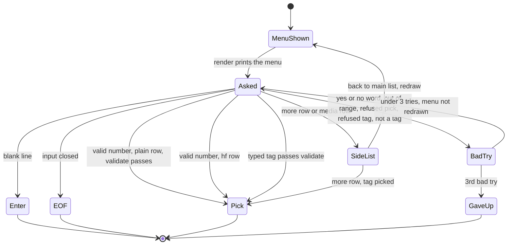

# Model menu split: layer map

This is a map of where the terminal model menu lives before and after the move, not a screen. The user flow does not change: same prompts, same numbers, same three tries. Only the address of each name changes, like moving a shop to a bigger street and leaving a sign at the old door.

## 1. What moves

| Name | File today | File after | PR |
|---|---|---|---|
| FIT_TEXT | model_wizard.py:96 | agl/ui/model_menu.py | A |
| LEGEND | model_wizard.py:97 | agl/ui/model_menu.py | A |
| _row_line | model_wizard.py:100 | agl/ui/model_menu.py | A |
| render | model_wizard.py:116 | agl/ui/model_menu.py | A |
| _search_size_text | model_wizard.py:153 | agl/ui/model_menu.py | A |
| _search_pick | model_wizard.py:163 | agl/ui/model_menu.py | A |
| _gave_up | model_wizard.py:180 | agl/ui/model_menu.py | A |
| TAG_RE | model_wizard.py:49 | agl/ui/model_menu.py | B |
| MAX_PICK_DIGITS | model_wizard.py:52 | agl/ui/model_menu.py | A |
| CATALOG_VERIFIED | model_wizard.py:58 | agl/core/menu.py | A |
| _ask_hf_tag | model_wizard.py:193 | agl/ui/model_menu.py | B |
| YES_NO | model_wizard.py:227 | agl/ui/model_menu.py | B |
| _sub_list | model_wizard.py:230 | agl/ui/model_menu.py | B |
| _more_pick | model_wizard.py:241 | agl/ui/model_menu.py | B |
| _media_rows | model_wizard.py:262 | agl/ui/model_menu.py | B |
| _media_loop | model_wizard.py:278 | agl/ui/model_menu.py | B |
| _pick_row | model_wizard.py:302 | agl/ui/model_menu.py | B |
| _number_answer | model_wizard.py:319 | agl/ui/model_menu.py | B |
| _tag_answer | model_wizard.py:329 | agl/ui/model_menu.py | B |
| choose | model_wizard.py:338 | agl/ui/model_menu.py | B |

Stays in model_wizard.py: the re-exports (CATALOG_VERIFIED among them, so `model_wizard.CATALOG_VERIFIED` still works), and the shims _hf_api_model (61), hf_check (68), hf_repo_info (79), _SameHostOnly (85), _STATE (86), hf_tree_files (89), tag_exists (392), registry_reachable (397). Tests patch these, so they stay put.

## 2. Import arrows after the move

```
agl/ui/model_menu.py  -> agl/core/menu
agl/ui/model_menu.py  -> agl/core/capabilities
agl/ui/model_menu.py  -> stdlib (re, from PR B only)
model_wizard.py       -> agl/ui/model_menu   (re-export, old imports keep working)
model_wizard.py       -> agl/core/menu       (re-export, now includes CATALOG_VERIFIED)
agl/app/server.py     -> agl/core/vscode_models   (DEFAULT_ENDPOINTS, replaces the literals on lines 8 and 20)
```

One cycle to dodge, and we can dodge it. `render` reads CATALOG_VERIFIED (line 145) and `_search_pick` reads MAX_PICK_DIGITS (line 175). Leave both behind and model_menu.py has to import back into model_wizard.py. So PR A takes them along: MAX_PICK_DIGITS goes to model_menu.py, and CATALOG_VERIFIED goes to agl/core/menu.py, next to the catalog it dates. model_wizard.py re-exports both, and the function bodies stay as they are.

## 3. Line counts

| File | Before | After PR A | After PR B |
|---|---|---|---|
| model_wizard.py | 401 (measured) | 307 (inferred) | 115 (inferred) |
| agl/ui/model_menu.py | 0, file absent | 111 (inferred) | 315 (inferred) |

How the inferred numbers add up:

- model_wizard.py, PR A: 401 - 97 (lines 96 to 192) - 2 (MAX_PICK_DIGITS) - 5 (CATALOG_VERIFIED and its comment) + 10 (re-exports) = 307.
- model_wizard.py, PR B: 307 - 204 (lines 193 to 391, TAG_RE, the `re` and `capabilities` imports) + 12 (re-export names) = 115.
- model_menu.py, PR A: 95 body lines (96 to 190) + 2 (MAX_PICK_DIGITS) + 14 header lines (docstring, imports, blanks) = 111.
- model_menu.py, PR B: 111 + 204 (same spans as above, plus two new imports) = 315.
- agl/core/menu.py gains about 5 lines in PR A.

## 4. Answer loop states (unchanged by this move)

This is what `choose` does today, read straight from the code. Nothing here is new behavior.



A few things the diagram leaves out on purpose:

- `how` ends as `enter`, `eof`, `gave_up` or `pick`.
- The side lists have their own loops, and those do not count toward `choose`'s three tries. `_ask_hf_tag` runs three tries of its own, then prints its own gave-up line and returns the fallback with `how` still `pick`. `_more_pick` and `_media_loop` just go back to the main list.
